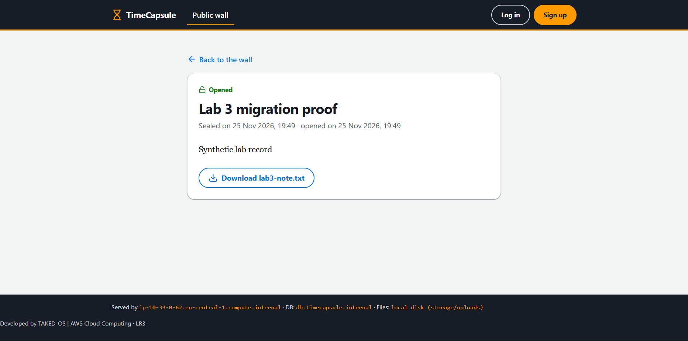
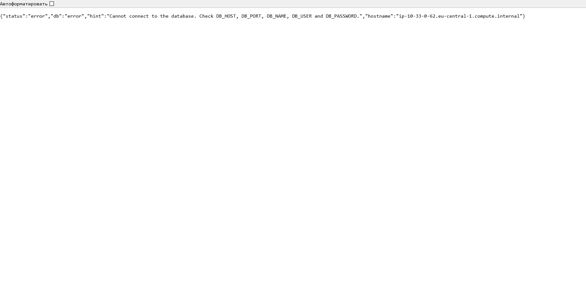
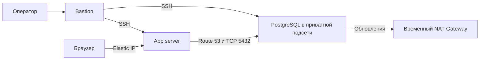

# Advanced. Перенос приложения в Amazon VPC

[Отчёт Basic](Мартынюк%20Петр%20Отчет.md) · [Задание Moodle](https://elearning.usm.md/mod/assign/view.php?id=341384)

| Пункт | Результат |
| --- | --- |
| 8 | В изолированной VPC создал учебный источник из опубликованной версии приложения и запустил app-server из его AMI. Источник и цель находились в разных подсетях одной VPC. Для переноса взял синтетические данные. |
| 9 | Привязал Elastic IP и проверил HTTP по этому адресу. Отдельная проверка входа прошла позднее через SSH-туннель к учебной копии. |
| 10–11 | Разместил PostgreSQL в приватной подсети и разрешил доступ от группы приложения. Имя `db.timecapsule.internal` разрешалось внутри VPC и не разрешалось с моего компьютера. |
| 12 | Перенёс 2 пользователей и 1 капсулу через `pg_dump` и `psql`. После переключения `/health` вернул `db: ok`, SHA-256 вложения совпал. |
| 13 | Выложил учебное изменение через `git pull` из локального Git bundle. При остановке БД главная страница и `/health` вернули HTTP 500. После запуска `/health` вернулся к HTTP 200. Временный NAT использовал при обновлении пакетов. |
| 14 | Сравнил размещение БД на сервере приложения, на отдельном EC2 в публичной подсети и на отдельном EC2 в приватной подсети. Для учебной схемы выбрал приватную подсеть. |

Капсула и вложение сохранились после переноса учебных данных. Проверки Elastic IP и входа проводил отдельно. Вход по Elastic IP в этом прогоне не подтвердил.

Тестовый источник завершён, AMI, снимок, NAT и временные публичные адреса удалены. Оригинальный webserver остался остановленным. Учебная VPC, приватная зона и три остановленных EC2 сохранены для следующих работ.

[ADR-0002](advanced-evidence/ADR-0002.md)
