# Лабораторная работа №3 — Облачные сети. Amazon VPC

**Студент:** Мартынюк Петр  
**Группа:** IA2404  
**Специальность:** Informatică aplicată (Прикладная информатика)  
**Порядковый номер в группе:** `k = 15`  
**Уровень:** базовый (задания 1–7)  
**Регион AWS:** `eu-central-1` — Europe (Frankfurt)  
**Проект:** `timecapsule`, окружение `dev`  
**Дата выполнения:** 4–5 ноября 2026 г.

## 1. План адресов (задание 1)

По условию `X = k mod 30 = 15 mod 30 = 15`. Выбранная VPC: **`10.15.0.0/16`**.

| Подсеть | Зона доступности | CIDR | Первый доступный IP | Последний доступный IP | Доступно адресов |
|---|---|---|---|---|---:|
| `public-a` | `eu-central-1a` | `10.15.0.0/24` | `10.15.0.4` | `10.15.0.254` | 251 |
| `public-b` | `eu-central-1b` | `10.15.1.0/24` | `10.15.1.4` | `10.15.1.254` | 251 |
| `private-a` | `eu-central-1a` | `10.15.10.0/24` | `10.15.10.4` | `10.15.10.254` | 251 |
| `private-b` | `eu-central-1b` | `10.15.11.0/24` | `10.15.11.4` | `10.15.11.254` | 251 |

AWS резервирует пять адресов каждой подсети `/24` (`.0`, `.1`, `.2`, `.3`, `.255`), поэтому для сетевых интерфейсов EC2 доступен **251 адрес**. В VPC `/16` теоретически помещаются 256 отдельных диапазонов `/24`, из которых четыре выделены, а **252** остаются неиспользованными.

## 2. VPC и подсети (задание 2)

Создана отдельная VPC `timecapsule-dev-vpc` с CIDR `10.15.0.0/16`. Включены `DNS resolution` и `DNS hostnames`; внутри VPC созданы две публичные и две приватные подсети, распределённые между `eu-central-1a` и `eu-central-1b`.

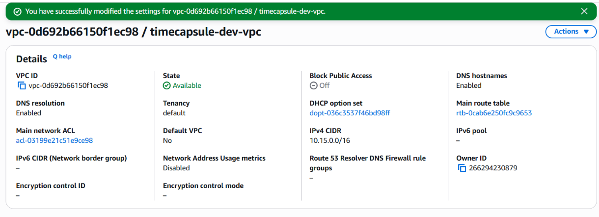

*Рисунок 1 — VPC `timecapsule-dev-vpc` в состоянии Available; DNS resolution и DNS hostnames включены.*

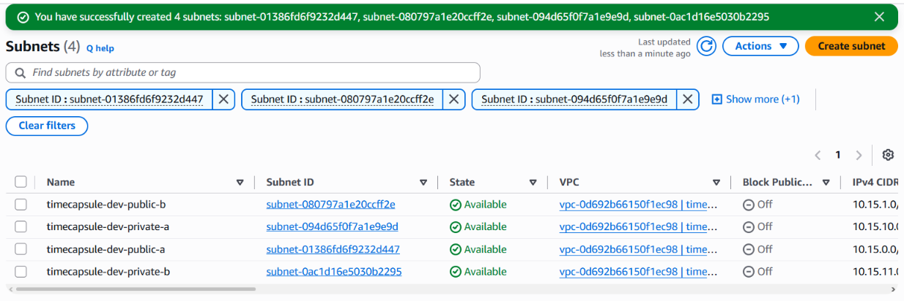

*Рисунок 2 — Четыре созданные подсети проекта, находящиеся в состоянии Available.*

## 3. Internet Gateway и таблицы маршрутов (задание 3)

Создан Internet Gateway `timecapsule-dev-igw` и подключён к `timecapsule-dev-vpc`. Таблица `public-rt` содержит маршруты `10.15.0.0/16 → local` и `0.0.0.0/0 → Internet Gateway`. Таблица `private-rt` после завершения временной установки пакетов оставлена только с локальным маршрутом; обе публичные подсети явно привязаны к `public-rt`, обе приватные — к `private-rt`.

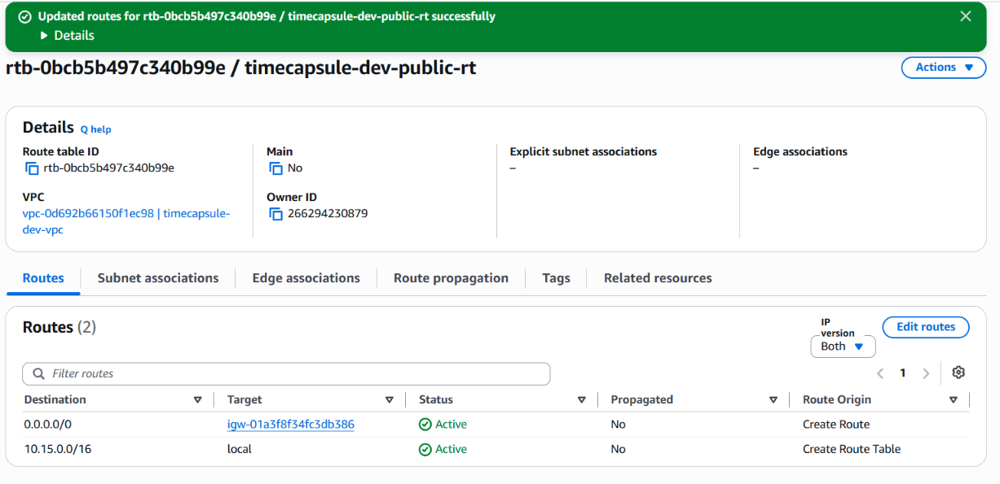

*Рисунок 3 — Маршруты `public-rt`: локальный и маршрут `0.0.0.0/0` через Internet Gateway.*


*Рисунок 4 — `public-a` и `public-b` явно связаны с `public-rt`.*

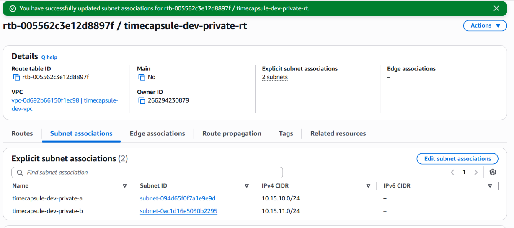

*Рисунок 5 — `private-a` и `private-b` явно связаны с `private-rt`.*

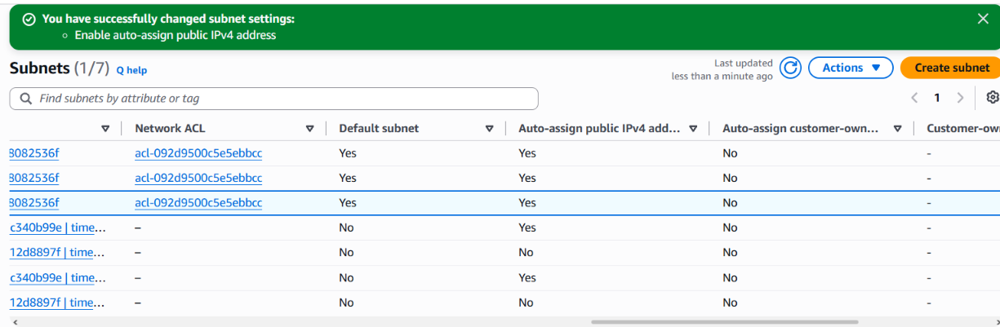

*Рисунок 6 — В списке подсетей отражена автоматическая выдача IPv4 для двух публичных подсетей; у приватных она отключена.*

## 4. Security Groups (задание 4)

Созданы три группы безопасности в VPC `timecapsule-dev-vpc`. Для исходящего трафика оставлены стандартные разрешающие правила; входящий трафик ограничен следующим образом:

| Security Group | Входящие правила | Назначение |
|---|---|---|
| `timecapsule-dev-bastion-sg` | SSH TCP/22 с `My IP /32` | Администрирование с компьютера |
| `timecapsule-dev-web-sg` | HTTP TCP/80 с `0.0.0.0/0`; SSH TCP/22 из `bastion-sg` | Публичный сайт и защищённый SSH |
| `timecapsule-dev-db-sg` | PostgreSQL TCP/5432 из `web-sg`; SSH TCP/22 из `bastion-sg` | База доступна приложению и администратору по разрешённым протоколам |

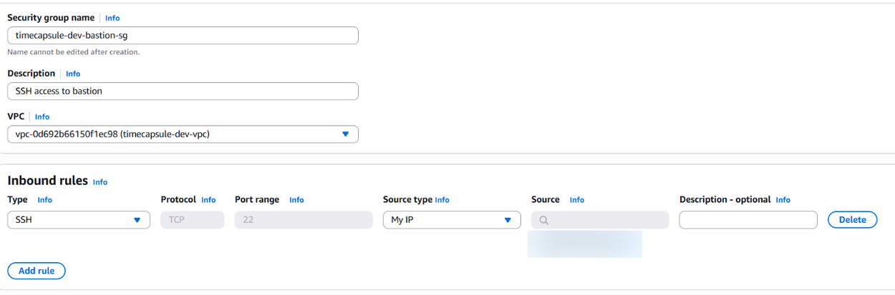

*Рисунок 7 — В `bastion-sg` разрешён входящий SSH с одного внешнего IP (адрес скрыт).* 

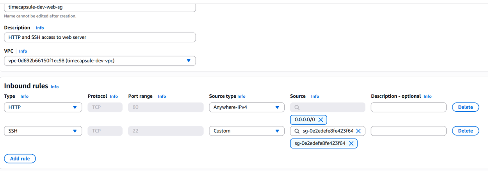

*Рисунок 8 — В `web-sg` разрешён HTTP для всех и SSH только от `bastion-sg`.*

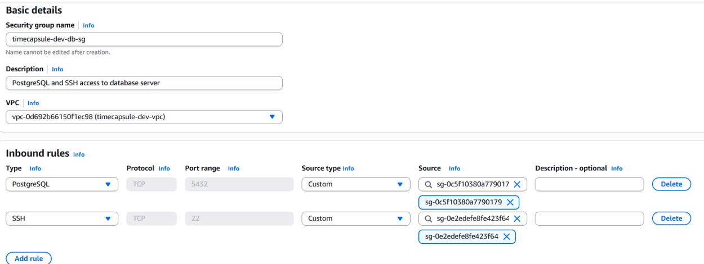

*Рисунок 9 — В `db-sg` порт 5432 разрешён от `web-sg`, а порт 22 — от `bastion-sg`.*

## 5. Экземпляры и доступ через bastion (задание 5)

Запущены три экземпляра `t3.micro` под Amazon Linux 2023 с ключом `cloudstudent-keypair`. У `bastion` и `web` имелись публичные адреса, а `db-server` размещён в приватной подсети без публичного IP.

| Имя EC2 | Подсеть | Приватный IP | Публичный IP при выполнении | Security Group |
|---|---|---|---|---|
| `timecapsule-dev-bastion` | `public-b` | `10.15.1.119` | `3.70.138.108` | `bastion-sg` |
| `timecapsule-dev-web` | `public-a` | `10.15.0.72` | `18.199.84.192` | `web-sg` |
| `timecapsule-dev-db` | `private-a` | `10.15.10.253` | отсутствует | `db-sg` |

Веб-сервер при запуске получил `User data` для установки `nginx`; сайт открывался по HTTP и отображал имя EC2 и его внутренний адрес. На Windows настроен SSH ProxyJump через bastion; успешно выполнялись подключения `ssh bastion`, `ssh web` и `ssh db`.

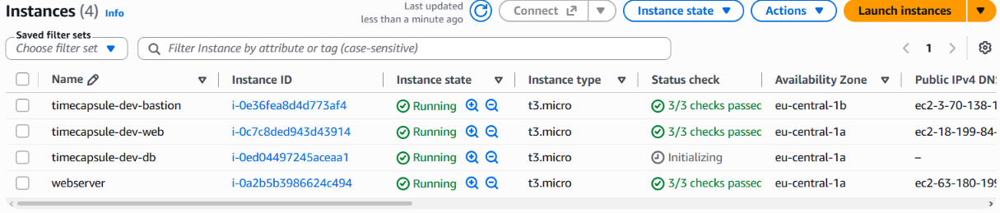

*Рисунок 10 — Три EC2-сервера лабораторной запущены в требуемых зонах доступности.*

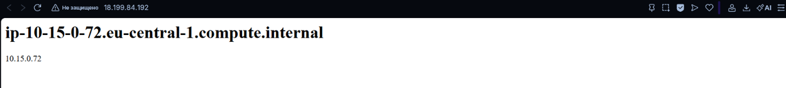

*Рисунок 11 — Страница nginx доступна по публичному IP и показывает приватный адрес `10.15.0.72`.*

До создания NAT Gateway установка `postgresql16-server` на `db-server` не удалась: при скачивании метаданных репозитория возник тайм-аут.

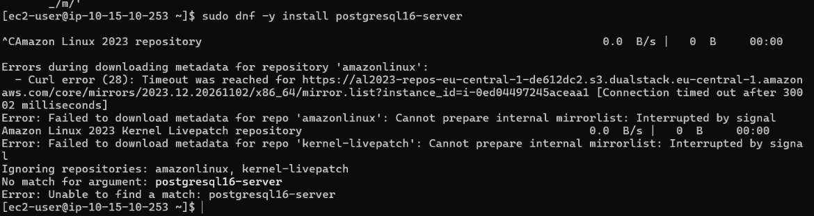

*Рисунок 12 — `dnf` на `db-server` не смог получить метаданные репозитория до настройки NAT.*

## 6. Временный NAT Gateway и PostgreSQL (задание 6)

Для временного доступа в интернет создан публичный `timecapsule-dev-nat-a` в `public-a` с Elastic IP `35.156.183.110`. В `private-rt` временно добавлен маршрут `0.0.0.0/0 → NAT Gateway`. Выходящий адрес `db-server`, определённый через `curl https://checkip.amazonaws.com`, совпал с Elastic IP NAT, после чего PostgreSQL 16 был установлен и инициализирован.

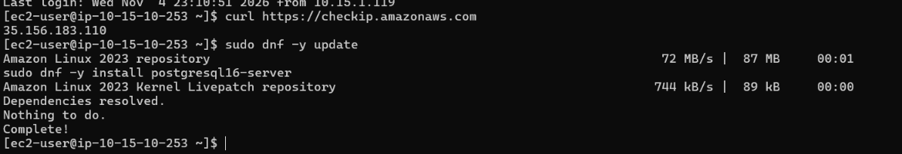

*Рисунок 13 — Внешний адрес запроса с `db-server`: `35.156.183.110`, адрес временного NAT Gateway.*

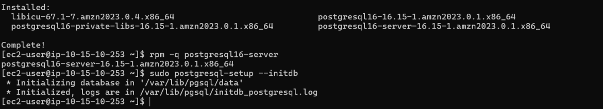

*Рисунок 14 — Пакет `postgresql16-server` установлен, команда `postgresql-setup --initdb` выполнена.*

В `postgresql.conf` задано `listen_addresses = '*'`. В `pg_hba.conf` добавлено правило `host all all 10.15.0.0/24 scram-sha-256`; сервис PostgreSQL включён и запущен. Созданы пользователь `student` и база `lab3`, владельцем которой он является.

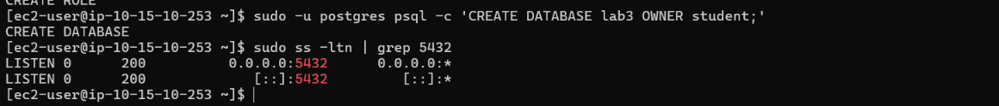

*Рисунок 15 — Созданы роль `student` и база `lab3`; PostgreSQL прослушивает TCP/5432.*

После установки NAT Gateway удалён. Временный маршрут перешёл в `Blackhole`, затем был удалён из `private-rt`; Elastic IP освобождён.

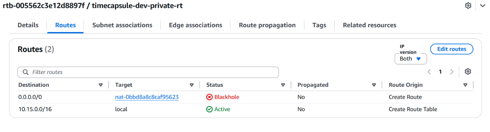

*Рисунок 16 — Маршрут к удалённому NAT Gateway в состоянии `Blackhole` перед очисткой таблицы.*

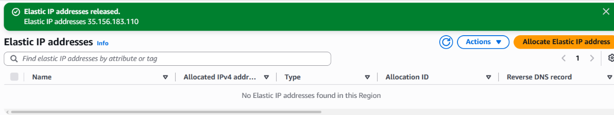

*Рисунок 17 — Elastic IP `35.156.183.110` освобождён; список выделенных Elastic IP пуст.*

## 7. Проверки сети (задание 7)

### 7.1. Подключение к PostgreSQL

На `web-server` установлен пакет клиента `postgresql16`; выполнена команда:

```bash
psql -h 10.15.10.253 -U student -d lab3 -c 'SELECT version();'
```

После успешной авторизации сервер вернул **PostgreSQL 16.15**.

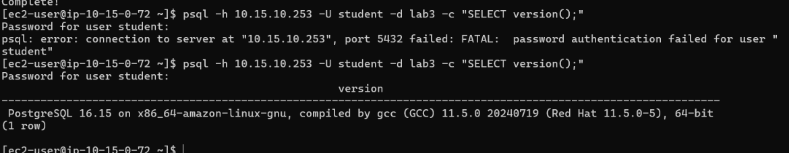

*Рисунок 18 — Успешное подключение к `lab3` с `web-server` и вывод `SELECT version()`.*

### 7.2. Security Group и порт 5432

Проверка TCP-соединения с `web-server` вернула `open`, а с `bastion` — `closed`. Это подтверждает, что `db-sg` допускает PostgreSQL-трафик только от `web-sg`.

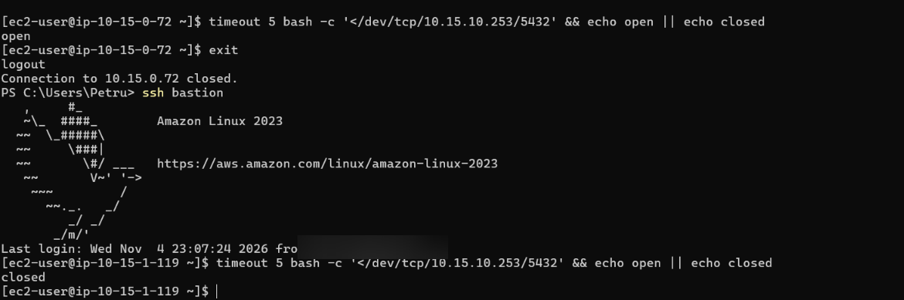

*Рисунок 19 — Проверка порта 5432: `open` с веб-сервера и `closed` с bastion.*

### 7.3. Отсутствие доступа в интернет с db-server

После удаления NAT Gateway команда `curl -m 5 https://github.com` на `db-server` завершилась тайм-аутом. Система продолжала допускать внутренние SSH-подключения через bastion и подключения к PostgreSQL по внутренней сети.

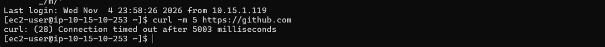

*Рисунок 20 — `curl` на `db-server` не может установить внешнее соединение за пять секунд.*

### 7.4. Эксперимент с Network ACL

Во входящие правила стандартного ACL проекта временно добавлено правило №90 с действием `DENY` для внешнего IP компьютера (`/32`). После сохранения SSH на bastion перестал работать и сайт не загружался с домашнего компьютера, но продолжал открываться с телефона через мобильный интернет. После удаления правила №90 SSH и сайт вновь заработали.

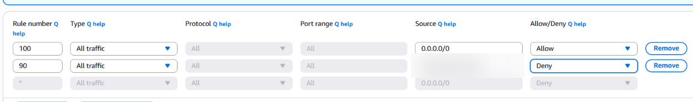

*Рисунок 21 — Правило №90 запрещает весь трафик с одного IP; точный домашний IP скрыт.*

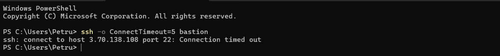

*Рисунок 22 — SSH к bastion с компьютера завершается `Connection timed out`.*


*Рисунок 23 — Веб-страница не загружается с компьютера во время действия правила №90.*

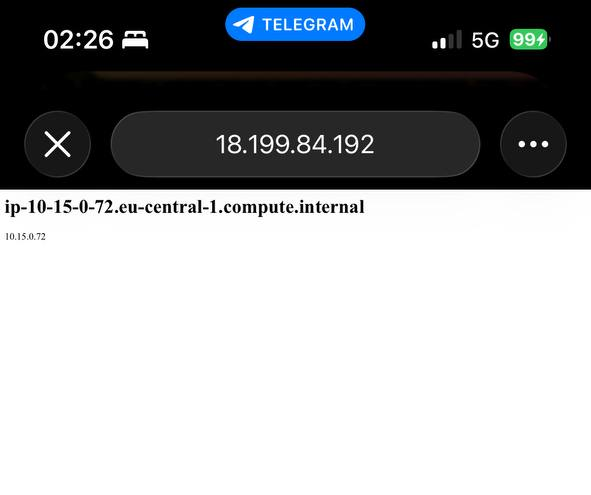

*Рисунок 24 — Тот же сайт открывается с телефона через сеть 5G.*

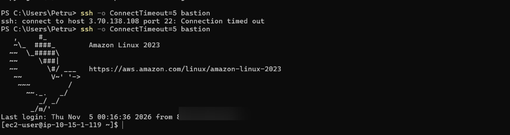

*Рисунок 25 — После удаления правила №90 SSH-подключение к bastion восстановлено.*

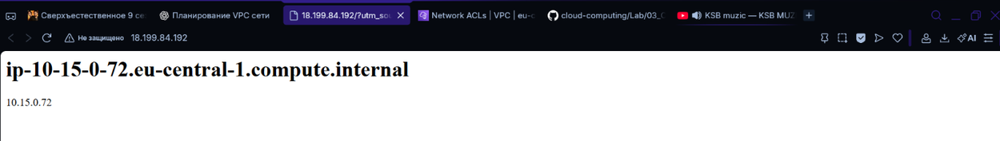

*Рисунок 26 — После удаления правила №90 веб-страница вновь доступна с компьютера.*

### 7.5. Теги ресурсов

В `Tag Editor` выполнен поиск ресурсов по тегу `Project = timecapsule` в регионе `eu-central-1`. В показанном списке ресурсы имеют по пять тегов. Для каждого ресурса использовались ключи `Name`, `Project`, `Environment`, `Owner`, `Lab`.

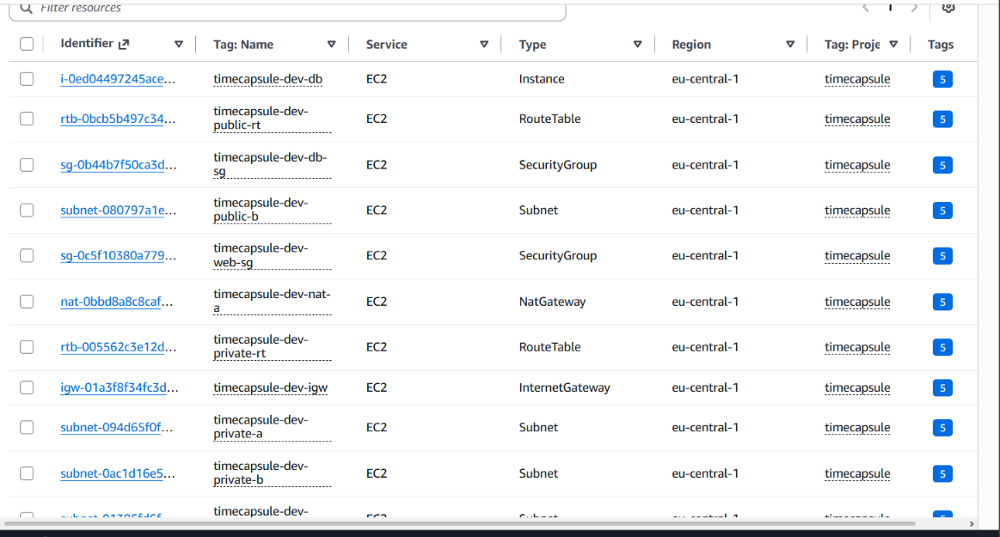

*Рисунок 27 — Результаты Tag Editor по тегу `Project = timecapsule`; у видимых ресурсов по пять тегов.*

### 7.6. Остановка инстансов

Три EC2-инстанса лабораторной остановлены. Экземпляр `webserver` из ЛР2 не изменён.

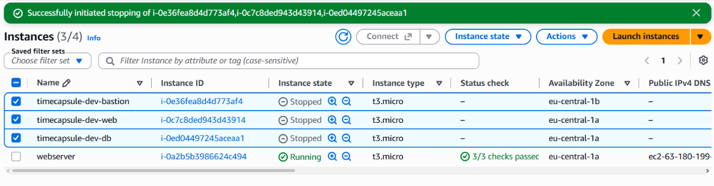

*Рисунок 28 — `timecapsule-dev-bastion`, `timecapsule-dev-web` и `timecapsule-dev-db` находятся в состоянии `Stopped`.*

## 8. Итог

Построена VPC `10.15.0.0/16` с четырьмя подсетями и двумя таблицами маршрутов. Веб-сервер был доступен через Internet Gateway, база находилась в изолированной приватной подсети, а доступ администратора к обоим внутренним ресурсам выполнялся через bastion с SSH ProxyJump.

Установлен PostgreSQL 16, проверена доступность порта 5432 только из разрешённой Security Group и блокировка входящего трафика через Network ACL. Временный NAT Gateway удалён, выделенный Elastic IP освобождён, а три учебных EC2-инстанса остановлены. Следует учитывать, что диски EBS продолжают тарифицироваться даже у остановленных экземпляров.

На рисунках 16 и 17 показаны удаление временного интернет-маршрута и освобождение Elastic IP. Итоговое состояние серверов представлено на рисунке 28.

## 9. Контрольные вопросы

### Задание 1. Почему доступных адресов не 256? Какие адреса резервирует AWS? Сколько ещё подсетей `/24` поместится в VPC?

В диапазоне `/24` всего 256 адресов, но AWS резервирует пять: `.0` (адрес сети), `.1` (маршрутизатор VPC), `.2` (DNS), `.3` (резерв AWS) и `.255` (последний адрес диапазона). Поэтому для экземпляров остаётся 251 адрес. В сети `/16` возможно 256 подсетей `/24`; после выделения четырёх остаётся 252.

### Задание 2. Является ли `public-a` публичной сразу после создания?

Нет. Название `public-a` не определяет публичность: сначала подсеть имеет только локальный маршрут внутри VPC. Публичной она становится после привязки к таблице с маршрутом `0.0.0.0/0` через Internet Gateway; экземпляру также необходим публичный IP для обмена с интернетом.

### Задание 3. Какой маршрут добавляется автоматически? Куда пойдёт пакет из `private-a` на `8.8.8.8`?

В обеих таблицах автоматически присутствует маршрут `10.15.0.0/16 → local`, обеспечивающий обмен между подсетями одной VPC. После удаления NAT Gateway у `private-rt` нет маршрута по умолчанию. Поэтому пакет на внешний адрес `8.8.8.8` не получает подходящего маршрута и не выходит в интернет.

### Задание 4. Почему источник в `db-sg` задан как `web-sg`, а не IP или вся VPC?

Ссылка на Security Group разрешает доступ сетевым интерфейсам, на которых назначена `web-sg`, и не привязана к одному изменяемому IP-адресу. Разрешение всего диапазона VPC было бы слишком широким: тогда обращаться к PostgreSQL могли бы и другие серверы в сети, например bastion.

### Задание 5. Почему `db-server` не мог скачать пакеты? Как дать ему исходящий доступ без входящего?

В приватной таблице не было маршрута в интернет, и `db-server` не имел публичного IP. Для скачивания пакетов мы временно создали публичный NAT Gateway и добавили маршрут `0.0.0.0/0` в `private-rt`. NAT позволяет инициировать исходящие соединения, не делая сервер базы публично доступным для новых входящих соединений.

### Задание 6. Какой внешний адрес показал `curl`, и почему он не принадлежит `db-server`?

Команда вернула `35.156.183.110`, совпадающий с Elastic IP временного NAT Gateway. Шлюз подменяет исходный приватный IP адресом своего внешнего интерфейса и направляет ответ обратно инициатору. У `db-server` собственного публичного IPv4-адреса не было.

### Задание 6. Как защищён доступ к PostgreSQL тремя механизмами? Что будет при ошибке в одном?

Отсутствие публичного IP и прямого интернет-маршрута исключает обычное прямое подключение к приватному серверу извне. `db-sg` разрешает порт 5432 только от `web-sg`, а `pg_hba.conf` ограничивает диапазон клиентов и требует пароль. Ошибка в одной настройке ослабляет защиту или блокирует работу, но остальные уровни могут по-прежнему ограничивать доступ; это принцип многоуровневой защиты.

### Задание 6. Почему PostgreSQL работает без NAT? Что делать для будущих обновлений?

PostgreSQL работает локально на EC2 и использует внутреннюю сеть VPC, поэтому постоянное соединение с интернетом ему не требуется. NAT Gateway был нужен только для загрузки пакетов. Для будущих обновлений безопасности придётся временно восстановить контролируемый исходящий доступ, обновить систему и снова убрать NAT и маршрут.

### Задание 7. Почему порт 5432 открыт с web-server, но закрыт с bastion?

Локальный маршрут VPC обеспечивает сетевую достижимость между обеими подсетями, но сам по себе не разрешает соединение. Security Group `db-sg` допускает TCP/5432 от `web-sg`, а bastion использует `bastion-sg`. Поэтому проверка с веб-сервера вернула `open`, а с bastion — `closed`.

### Задание 7. Почему `curl` на db-server не работает? Можно ли открыть его порт 5432 из интернета?

После удаления NAT у приватной подсети остался только локальный маршрут VPC, а у сервера не было публичного IP. Поэтому внешний HTTPS-запрос завершился тайм-аутом, а прямое подключение из интернета на `5432` не имеет публичного адреса назначения. Дополнительно `db-sg` разрешает этот порт только со стороны `web-sg`.

### Задание 7. Почему Network ACL заблокировал и SSH, и сайт? Почему телефон работал? Зачем номер меньше 100?

Network ACL фильтрует трафик на границе подсетей независимо от Security Groups, поэтому правило `DENY All traffic` заблокировало и TCP/22, и TCP/80 для указанного IP. Телефон использовал мобильный интернет с другим внешним адресом, который не совпадал с запрещённым `/32`. Правила ACL оцениваются от меньшего номера к большему, поэтому запрет №90 сработал раньше разрешающего правила №100.

### Задание 7. Как найти ресурсы для удаления по тегам? Зачем `Owner` в личном аккаунте?

В Tag Editor можно выбрать регион и фильтровать ресурсы по `Project = timecapsule`, а затем по `Environment = dev` и `Lab = lab3`. Так проще найти связанные с лабораторной экземпляры, диски, сети и правила, не затронув другие проекты. Тег `Owner` помогает установить ответственного даже в личном аккаунте, особенно если позже появятся дополнительные пользователи или проекты.
