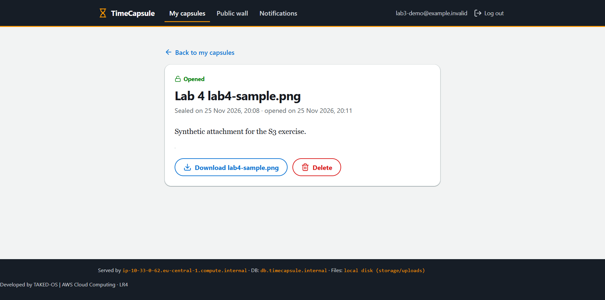
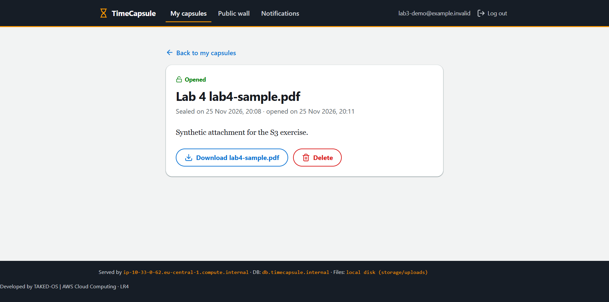
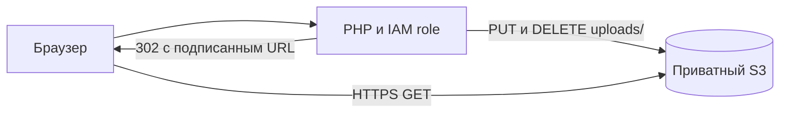

# Advanced. Вложения TimeCapsule в Amazon S3

[Отчёт Basic](README.md) · [Задание Moodle](https://elearning.usm.md/mod/assign/view.php?id=342402)

Для Advanced использовал отдельный приватный бакет с версионированием и обязательным HTTPS. Приложение на EC2 получало временные учётные данные через профиль экземпляра IAM.

| Пункты | Результат |
| --- | --- |
| 7–9 | Все 10 проверок тестовой роли дали ожидаемые разрешения или отказы. `uploads/` был доступен, `backups/` и удаление отдельной версии получили отказ. Запрос по HTTP отклонила политика бакета. |
| 10–11 | Перенёс существующее вложение через `aws s3 sync`. Повторный dry run не показал изменений. Приложение сохраняло файлы через AWS SDK и выдавало подписанный URL на пять минут. |
| 12 | Загрузил PNG и PDF и подтвердил HTTP 200, MIME и исходные имена. Старое вложение загрузилось из S3. Исходная ссылка PNG после пяти минут вернула HTTP 403. Удаление тестового PDF оставило версию и создало delete marker. |
| 13 | Убрал локальную папку `uploads` и разрешение `ListBucket`. Старые файлы скачались, новый PNG сохранился. При обращении к отсутствующему ключу роль EC2 получила 403, оператор получил 404. |
| 14 | Выбрал S3 вместо локального диска. Объекты остаются доступны при замене сервера, а версия и метка удаления позволяют восстановить файл. |

Учебные EC2 остановлены, временный IPv4 освобождён. Бакет и роль EC2 оставлены для защиты и следующих работ.

[ADR-0003](advanced-evidence/ADR-0003.md)
