# Лабораторная работа №4. Amazon S3

**Студент:** Мартынюк Петр  
**Группа:** IA2404  
**Специальность:** Informatică aplicată  
**Дисциплина:** Cloud Computing  
**Уровень:** Basic, задания 1–6  
**Дата:** 18 ноября 2026 года  
**Регион:** Europe (Frankfurt), `eu-central-1`

На скриншотах скрыты идентификатор аккаунта и служебные элементы личного интерфейса.

## Цель работы

Создать закрытый S3-бакет, освоить работу с объектами через консоль и CLI,
ограничить доступ HTTPS, проверить версии, настроить lifecycle и временный доступ
через подписанные URL. Для работы создан отдельный учебный бакет
`timecapsule-dev-uploads-cloudstudent-basic-20261118`. Ранее существовавшие ресурсы не использовались для опытов.

## 1. Бакет и объекты в консоли

Через AWS Console создан бакет General purpose со следующими настройками:

| Настройка | Значение |
|---|---|
| Регион | eu-central-1 |
| Object Ownership | Bucket owner enforced; ACLs disabled |
| Block Public Access | Все четыре ограничения включены |
| Начальное версионирование | Выключено; включено позднее в задании 4 |
| Шифрование | SSE-S3, AES256 |
| Теги | Name=lab4-basic-uploads, Project=CloudComputing, Environment=dev, Owner=cloudstudent, Lab=lab4 |

Кнопкой Create folder созданы `uploads/` и `backups/`. В `uploads/` загружены
`sample-image.png` и `sample-document.pdf`, в `backups/` — `backup.txt`.
Консоль подтвердила успешную загрузку файлов; список объектов дополнительно проверен API.

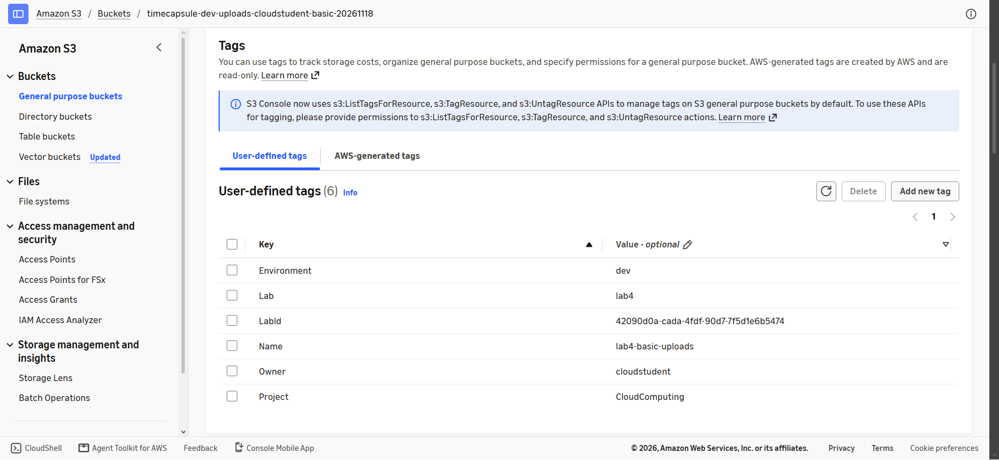

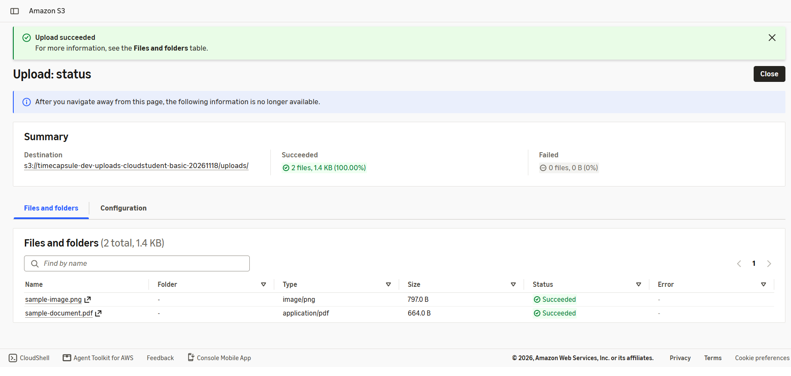

У картинки проверены следующие свойства:

| Свойство | Результат |
|---|---|
| Key | uploads/sample-image.png |
| Content-Type | image/png |
| Размер | 797 байт |
| ETag | 57dd26c1db032c67473440ff27b5012e |
| Object URL | `https://timecapsule-dev-uploads-cloudstudent-basic-20261118.s3.eu-central-1.amazonaws.com/uploads/sample-image.png` |

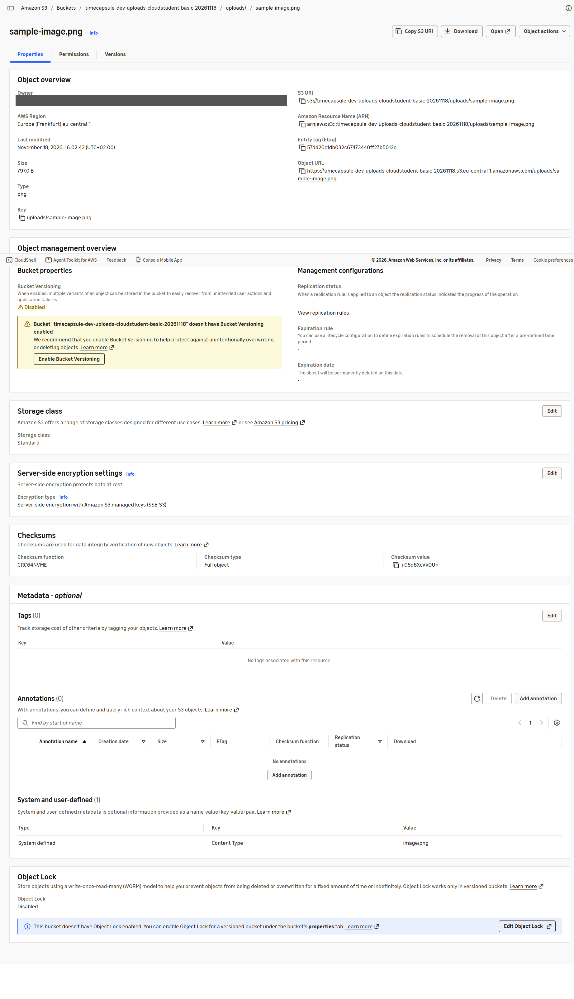

Открытие обычного Object URL вернуло **HTTP 403, AccessDenied**.

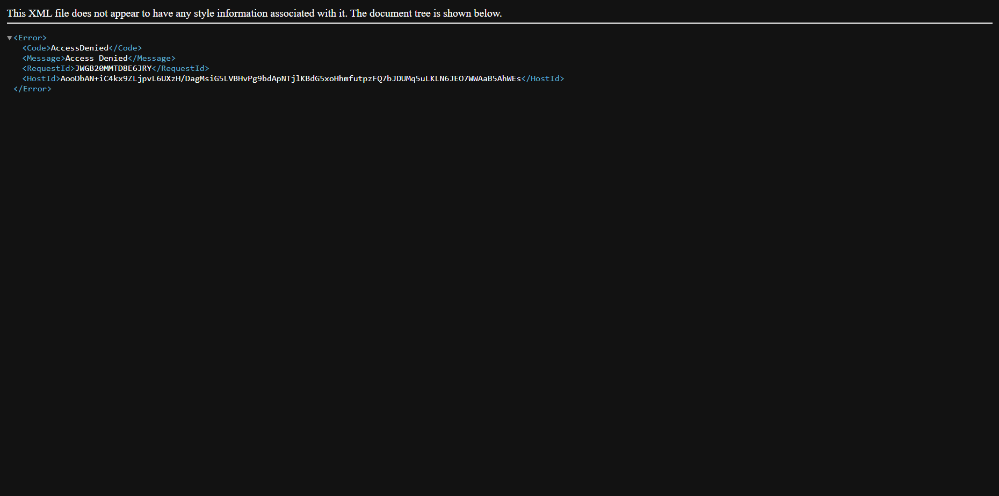

### Контрольные вопросы

**Какой ключ у картинки?** Ключ — `uploads/sample-image.png`. Он полностью идентифицирует объект внутри бакета, включая префикс `uploads/`; имя бакета в ключ не входит.

**Почему Object URL не открывается, хотя я владелец бакета?** Обычное открытие URL не подписывает запрос правами пользователя AWS Console. Бакет закрыт, поэтому анонимный GET не разрешён; для временного доступа в задании 6 используется подписанная ссылка.

**Что создала кнопка Create folder?** Она создала объект нулевого размера с ключом, заканчивающимся `/`. S3 хранит плоское пространство ключей, а папки в интерфейсе являются представлением префиксов.

## 2. Объекты из командной строки

Команды выполнены в AWS CloudShell в регионе `eu-central-1` от пользователя `cloudstudent`.

```bash
BUCKET=timecapsule-dev-uploads-cloudstudent-basic-20261118
mkdir -p lab4/2026/10 && cd lab4
printf 'photo placeholder\n' > photo.txt
printf 'october report\n' > 2026/10/report.txt
printf 'october report 2\n' > 2026/10/report-2.txt
aws s3 cp photo.txt s3://$BUCKET/uploads/photo.txt
aws s3 sync 2026 s3://$BUCKET/uploads/2026

aws s3 ls s3://$BUCKET
aws s3 ls s3://$BUCKET/uploads/
aws s3 ls s3://$BUCKET --recursive
```

Первый список содержит `PRE backups/` и `PRE uploads/`; список `uploads/`
дополнительно содержит `PRE 2026/`. Рекурсивный вывод показывает полные ключи,
включая `uploads/2026/10/report.txt` и `uploads/2026/10/report-2.txt`.

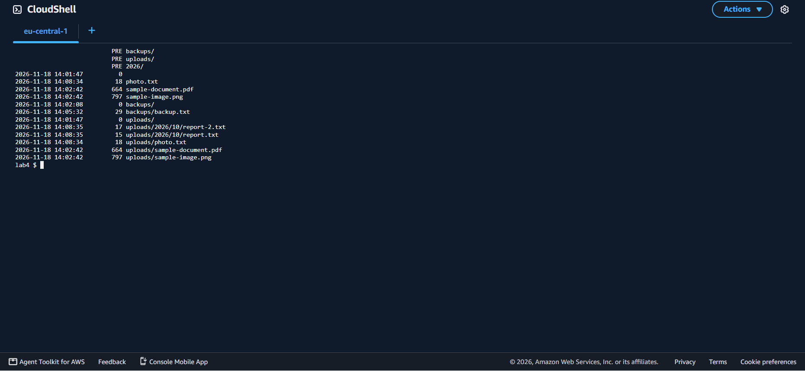

Метаданные прочитаны без скачивания содержимого:

```bash
aws s3api head-object --bucket $BUCKET --key uploads/sample-image.png
aws s3api head-object --bucket $BUCKET --key uploads/2026/10/report.txt
aws s3 cp s3://$BUCKET/uploads/photo.txt downloaded.txt && cat downloaded.txt
aws s3 rm s3://$BUCKET/uploads/2026/10/report-2.txt
```

Для картинки получен `image/png`, для `report.txt` — `text/plain`, размер 15 байт.
Скачанный файл содержит `photo placeholder`. Удалён только учебный `report-2.txt`;
последующий `ListObjectsV2` с его точным префиксом не вернул объектов.

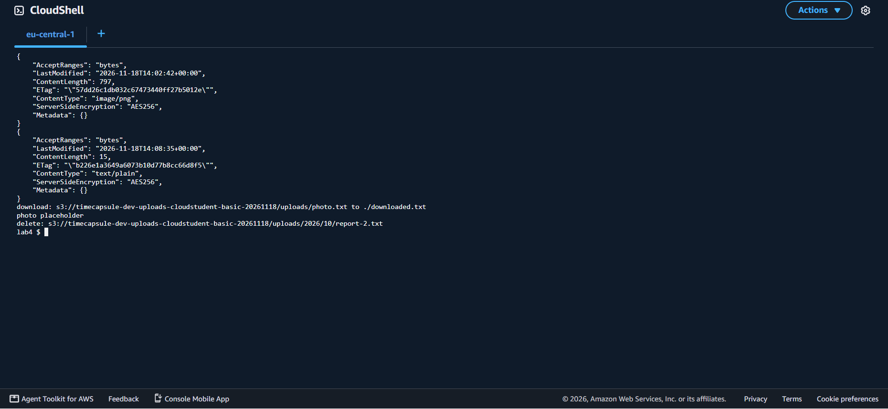

### Контрольные вопросы

**Почему первый ls показывает PRE, а третий — полные ключи?** Без `--recursive` CLI группирует ключи по разделителю `/`, показывая общие префиксы как `PRE`. Рекурсивный список не сворачивает их в папки и выводит каждый полный ключ.

**Какой Content-Type получил report.txt?** API вернул `text/plain`. CLI определил тип по расширению файла при загрузке, хотя параметр `--content-type` явно не задавался.

## 3. Политика бакета: только HTTPS

Для нового учебного бакета сохранена следующая политика. Другие бакеты и IAM-политики не изменялись.

```json
{
  "Version": "2012-10-17",
  "Statement": [{
    "Sid": "DenyInsecureTransport",
    "Effect": "Deny",
    "Principal": "*",
    "Action": "s3:*",
    "Resource": [
      "arn:aws:s3:::timecapsule-dev-uploads-cloudstudent-basic-20261118",
      "arn:aws:s3:::timecapsule-dev-uploads-cloudstudent-basic-20261118/*"
    ],
    "Condition": {"Bool": {"aws:SecureTransport": "false"}}
  }]
}
```

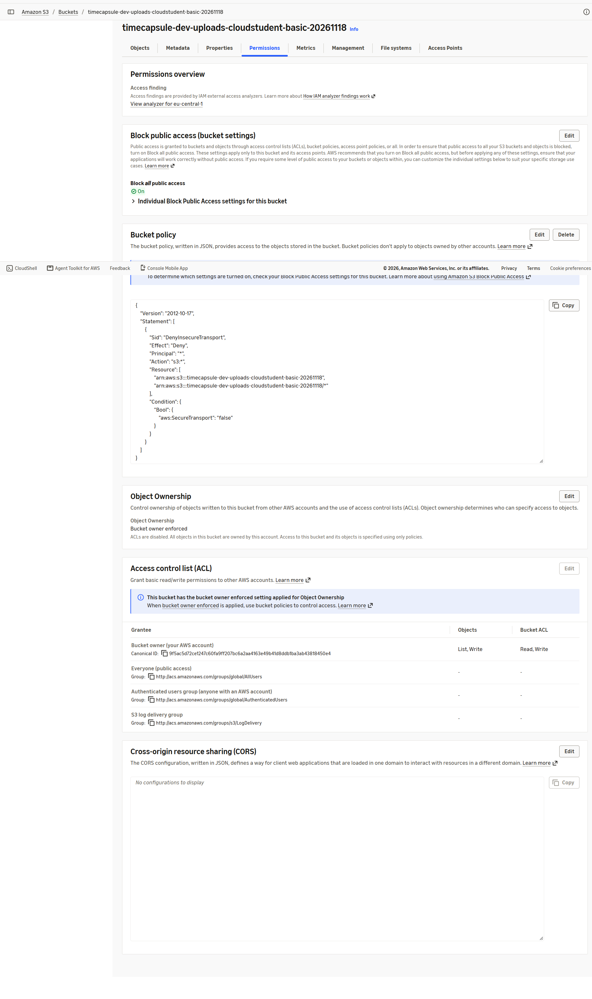

```bash
aws s3 ls s3://$BUCKET/uploads/
aws s3 ls s3://$BUCKET/uploads/ --endpoint-url http://s3.eu-central-1.amazonaws.com
```

HTTPS-запрос успешно показал список. HTTP-запрос вернул `AccessDenied` для
`ListObjectsV2` с пояснением `explicit deny in a resource-based policy`.

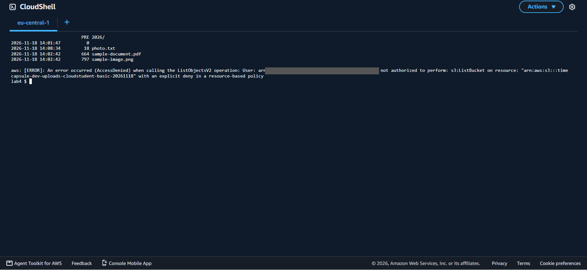

### Контрольные вопросы

**Почему HTTP получает AccessDenied при административных правах?** Явный Deny в ресурсной политике имеет приоритет над Allow. При HTTP условие `aws:SecureTransport=false` выполняется, поэтому запрос запрещён независимо от разрешающих прав пользователя.

**Почему Block Public Access разрешил Principal="*"?** Эта политика ничего не разрешает публике, а ограничивает небезопасный транспорт для всех. Поэтому она не создаёт публичного доступа и совместима с включённым Block Public Access.

## 4. Версионирование и защита от удаления

Все изменения в этом задании выполнены через S3 Console. После включения
Bucket Versioning ранее загруженные объекты остались с идентификатором `null`.

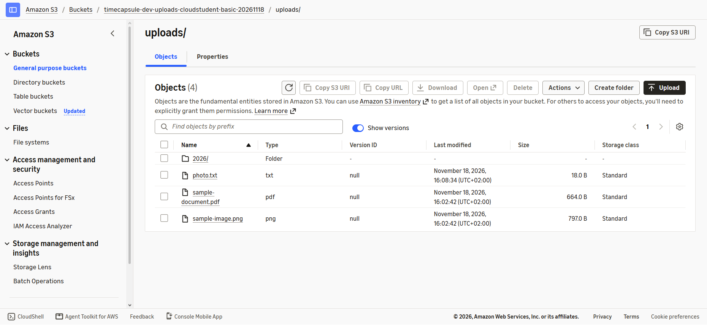

Создан `uploads/notes.txt` с текстом v1, затем под тем же ключом загружен v2.
При выключенном Show versions удалён текущий объект: появился Delete marker,
обе версии сохранились.

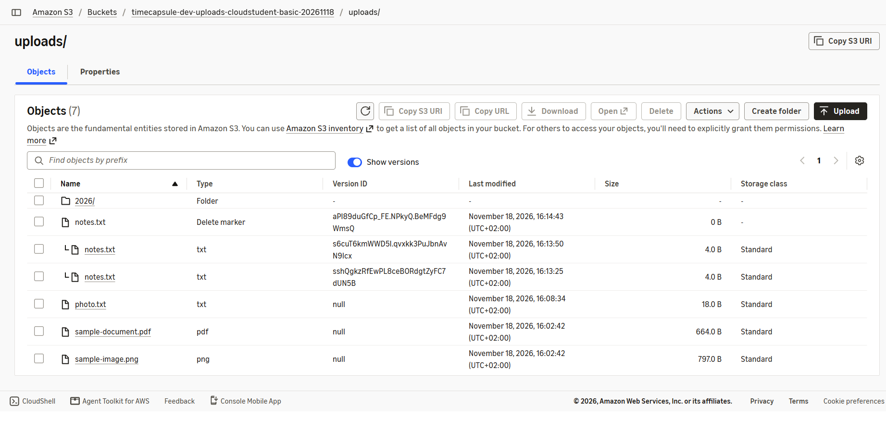

| Этап | VersionId | Результат |
|---|---|---|
| v1 | sshQgkzRfEwPL8ceBORdgtZyFC7dUN5B | Сохранена; итоговая текущая версия |
| v2 | s6cuT6kmWWD5I.qvxkk3PuJbnAvN9Icx | Восстановлена после удаления маркера; затем окончательно удалена для отката |
| Delete marker | aPl89duGfCp_FE.NPkyQ.BeMFdg9WmsQ | Удалён для восстановления объекта |

Удаление маркера восстановило v2. `GetObject` подтвердил текст `v2` и соответствующий VersionId.

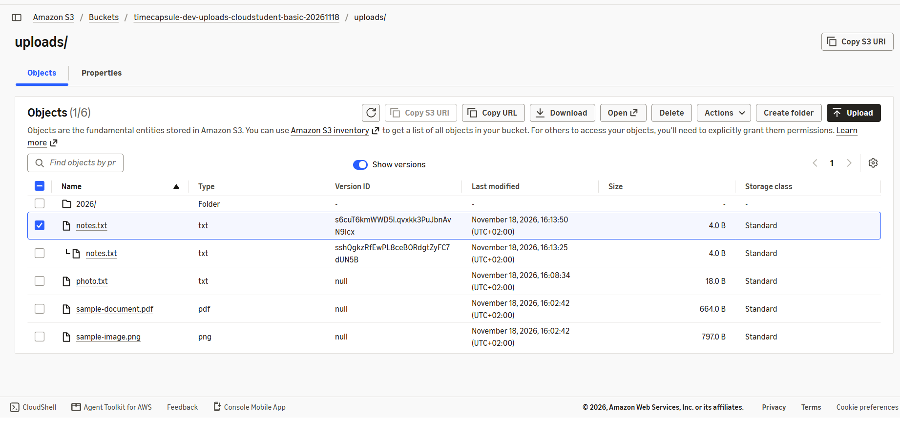

Затем окончательно удалена только v2. Консоль потребовала подтверждение
`permanently delete`, отличающееся от обычного `delete`.

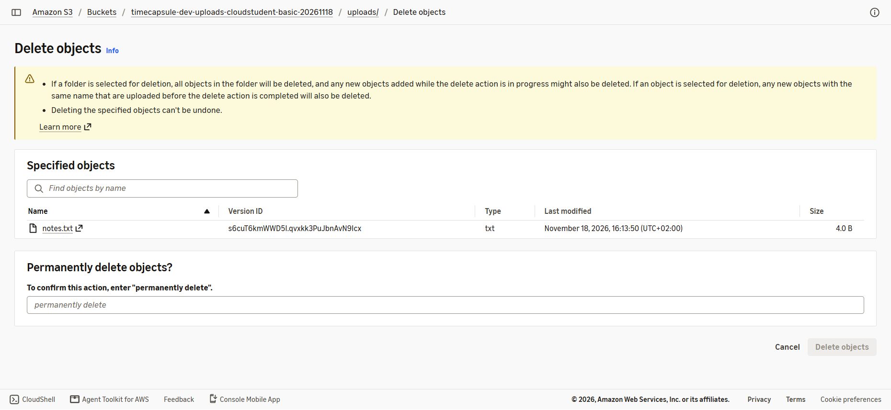

Повторные `ListObjectVersions` и `GetObject` подтвердили единственную версию v1,
текст `v1`, отсутствие v2 и маркера удаления.

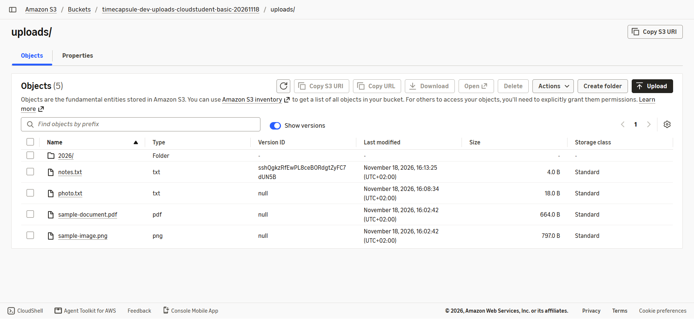

### Контрольные вопросы

**Чем отличаются два удаления и какое можно отменить?** Удаление без VersionId в бакете с включённым versioning создаёт маркер, скрывающий текущий объект; удаление этого маркера возвращает предыдущую версию. Удаление с конкретным VersionId окончательно уничтожает выбранную версию и средствами versioning не отменяется.

**Как защититься от случайного удаления и что запрещать приложению?** Versioning помогает восстановить объект после обычного удаления, пока нужные версии сохранены. Приложению без необходимости не следует выдавать `s3:DeleteObjectVersion`, иначе оно сможет уничтожать историю окончательно.

## 5. Правило жизненного цикла

Через Management → Create lifecycle rule создано правило `timecapsule-dev-noncurrent`.

| Параметр | Значение, подтверждённое API |
|---|---|
| Статус | Enabled |
| Filter.Prefix | uploads/ |
| NoncurrentVersionTransitions | 30 дней → STANDARD_IA |
| NoncurrentVersionExpiration | 90 дней, NewerNoncurrentVersions=2 |
| AbortIncompleteMultipartUpload | 7 дней после начала |
| TransitionDefaultMinimumObjectSize | all_storage_classes_128K |

Истечение текущих версий и удаление expired delete markers не включены.
Префикс `backups/` не соответствует фильтру и не затрагивается этим правилом.

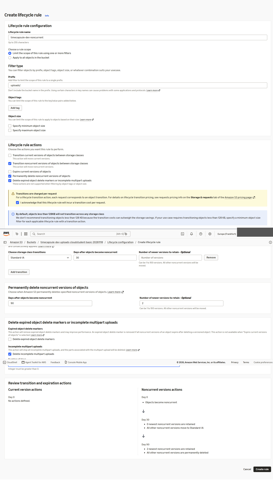

На полном скриншоте поле срока multipart частично перекрыто закреплённой панелью.
Сохранённый ответ `GetBucketLifecycleConfiguration` подтверждает его значение:

```json
"AbortIncompleteMultipartUpload": {"DaysAfterInitiation": 7}
```

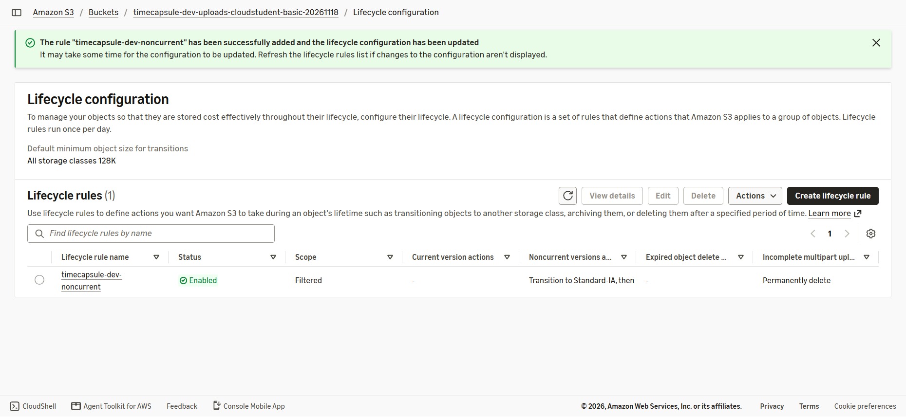

### Контрольные вопросы

**Что произойдёт после десяти перезаписей за неделю?** Текущая версия останется текущей, а предыдущие станут неактуальными в моменты последующих записей. Подходящие по размеру неактуальные версии перейдут в Standard-IA после 30 дней неактуальности; старые версии могут быть удалены после 90 дней только с одновременным соблюдением ограничения на сохранение двух последних неактуальных версий. Эти две версии не защищены от перехода в IA, поскольку retain=2 задан только для удаления.

**Почему маленькие файлы не попадут в Standard-IA?** У сохранённой конфигурации действует стандартный порог: объекты меньше 128 KB не переходят между классами по lifecycle. Все учебные файлы меньше этого порога, поэтому при текущих настройках перехода не произойдёт.

**Что такое незавершённая multipart-загрузка и почему она платная?** При multipart upload части загружаются отдельно и становятся итоговым объектом после CompleteMultipartUpload. Пока загрузка не завершена или не отменена, уже сохранённые части занимают оплачиваемое место; правило отменяет такие незавершённые загрузки через 7 дней.

## 6. Подписанные URL

В Object actions → Share with a presigned URL выбраны Minutes и срок 5 минут
для `uploads/sample-image.png`.

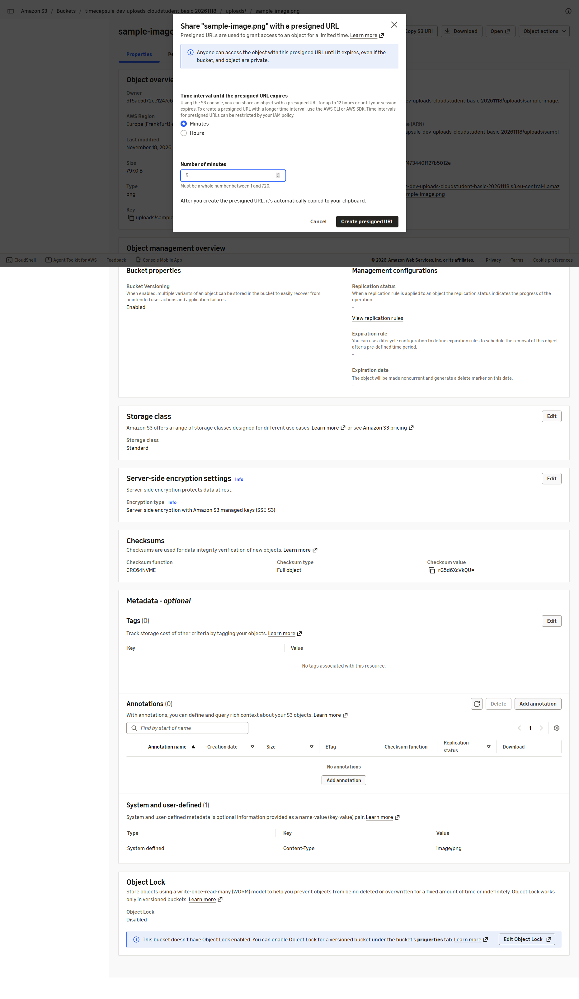

Ссылка открыта в приватном окне Opera вручную; успешное открытие подтверждено студентом.
На доступной странице изображения дополнительно проверены загрузка и естественный
размер 320×180; сохранён реальный скриншот содержимого без адресной строки.
Этот кадр подтверждает загрузку изображения, но сам по себе не показывает приватный режим окна.


В CloudShell создана отдельная CLI-ссылка на `uploads/photo.txt`:

```bash
LAB4_URL=$(aws s3 presign s3://$BUCKET/uploads/photo.txt --expires-in 120 --region eu-central-1)
```

Ссылка хранится только в переменной сеанса и не выводится. Её GET проверен
HTTP-клиентом Python в CloudShell; результаты показаны в настоящем терминале.
Исходный URL вернул **HTTP 200** и `photo placeholder`. В копии URL заменён
только путь `/uploads/photo.txt` на `/uploads/notes.txt`; ответ —
**HTTP 403, SignatureDoesNotMatch**.

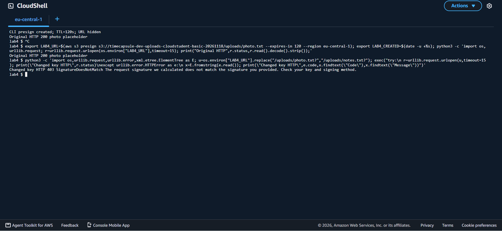

Через **150 секунд** после создания выполнен GET по той же исходной ссылке.
S3 вернул **HTTP 403, AccessDenied**, сообщение **Request has expired**.

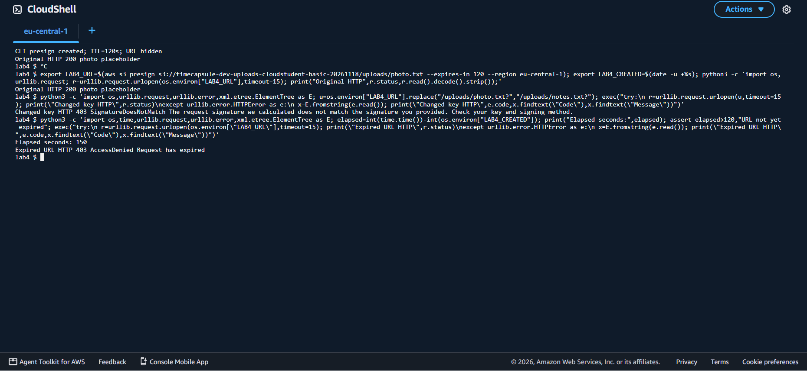

### Контрольные вопросы

**Какие ошибки вернул S3?** При замене ключа получена `SignatureDoesNotMatch` со статусом 403. После истечения срока получена `AccessDenied` со статусом 403 и сообщением `Request has expired`; обе ошибки зафиксированы реальными запросами.

**Почему нельзя изменить ключ и получить другой файл?** В Signature Version 4 подпись привязана к параметрам запроса, включая путь объекта. Изменение ключа меняет подписываемые данные, а прежняя подпись больше не подтверждает такой запрос.

**Обращалась ли aws s3 presign к S3 при создании ссылки?** Подпись URL формируется локально, без проверки существования объекта в S3; проверка доступа происходит при GET. При необходимости CLI может отдельно обращаться к источнику временных credentials для их получения или обновления — это не GET объекта S3.

## Состояние ресурсов и расходы

После проверки содержимого временная папка `~/lab4` удалена вручную в CloudShell
командой `rm -ri ~/lab4` с подтверждением удаления учебных файлов. Отсутствие
папки проверено командой:

```bash
test ! -e ~/lab4 && echo "Lab4 temporary files removed successfully"
```

Получен результат `Lab4 temporary files removed successfully`.
Предоставленный скриншот подтверждает проверку содержимого, удаление и отсутствие папки.
Учебный S3-бакет этой очисткой не затрагивался.

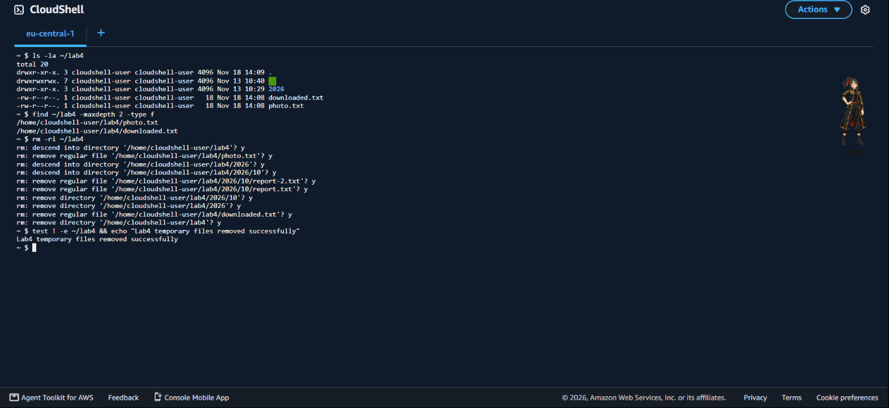

Бакет сохранён для проверки отчёта. В нём восемь текущих объектов, включая два
нулевых маркера папок; `notes.txt` содержит v1. `report-2.txt`, учебная v2 и
маркер удаления отсутствуют; незавершённых multipart-загрузок нет.
Никаких EC2, VPC или NAT Gateway для этой работы не создавалось и не изменялось.

По AWS Pricing API S3 Standard в Frankfurt стоит 0.0245 USD/GB-месяц в первом
диапазоне; PUT/COPY/POST/LIST — 0.0054 USD за 1000 запросов, GET и прочие
запросы этой категории — 0.00043 USD за 1000. Восемь сохранённых объектов занимают
1527 байт: расчётная плата за их хранение составляет около 0.000000035 USD за месяц.
Для ориентира 1000 запросов PUT/LIST и 1000 GET по этим ставкам стоят 0.00583 USD
до кредитов и налогов; это пример, а не измеренное количество запросов работы.
Фактический счёт может поступать
с задержкой и зависит от запросов, трафика и применённых кредитов.

Учебный бакет не удалён и сохраняется до проверки и защиты отчёта.

### Сохранение ресурсов для Basic №5–6

Учебный бакет №4 сохраняется до проверки и защиты отчёта. Он не является
зависимостью Basic №5 (RDS) или №6 (ALB/ASG): эти работы используют сеть №3.
Следует сохранить существующие VPC, подсети, маршруты, Internet Gateway,
Security Groups, bastion, EC2, подключённые EBS и пару ключей.
TimeCapsule, webserver и прежний S3-бакет не относятся к временным файлам этой работы.
Для RDS нужны приватные подсети в двух разных AZ; прежние private-a/private-b
по сохранённой проверке обе находятся в eu-central-1a, поэтому перед №5 требуется
отдельно подготовить подходящую подсеть в eu-central-1b, не удаляя существующие.

Проверка с исходным снимком подтвердила прежние состояния и размещение EC2,
подключения EBS, параметры VPC и отсутствие NAT Gateway. Ключи, размеры и ETag
объектов ранее существовавшего бакета совпадают с исходными.

## Выводы

Проверены закрытый доступ к объектам, запрет HTTP, восстановление через маркер
удаления и откат версии. Lifecycle ограничен префиксом, а временный доступ по
подписи прекращается после истечения срока; изменение ключа нарушает подпись.

## Источники

- [Оригинальное задание Moodle](https://elearning.usm.md/mod/assign/view.php?id=342402)
- [Тарифы Amazon S3](https://aws.amazon.com/s3/pricing/)
- [Версионирование S3](https://docs.aws.amazon.com/AmazonS3/latest/userguide/Versioning.html)
- [Примеры lifecycle](https://docs.aws.amazon.com/AmazonS3/latest/userguide/lifecycle-configuration-examples.html)
- [Подписанные URL](https://docs.aws.amazon.com/AmazonS3/latest/userguide/using-presigned-url.html)

[Продвинутый уровень](Advanced.md)
