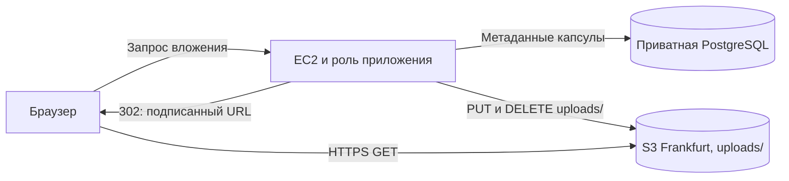

# ADR-0003. Хранение вложений

## Контекст

После ЛР3 PostgreSQL размещалась в приватной подсети, а вложения оставались на диске app-server. Замена этого сервера могла привести к потере файлов.

## Решение

Хранить вложения в приватном бакете S3 с версионированием. PHP получает временные полномочия из роли EC2. При скачивании приложение выдаёт подписанную ссылку на пять минут.

## Альтернативы

- Локальный диск прост в настройке. Вложения необходимо переносить при замене сервера.
- Общая файловая система сохраняет привычный файловый интерфейс. Для приложения с тремя операциями требуется управление дополнительным сервисом и сетевым доступом.
- S3 хранит объекты независимо от app-server. Приложению нужно формировать ключи и подписанные ссылки.

## Последствия

Файлы хранятся отдельно от экземпляров, поэтому можно заменить app-server, сохранив объекты и строки PostgreSQL. Роль ограничена ключами uploads/. Запросы, объекты и старые версии учитываются в стоимости S3.

