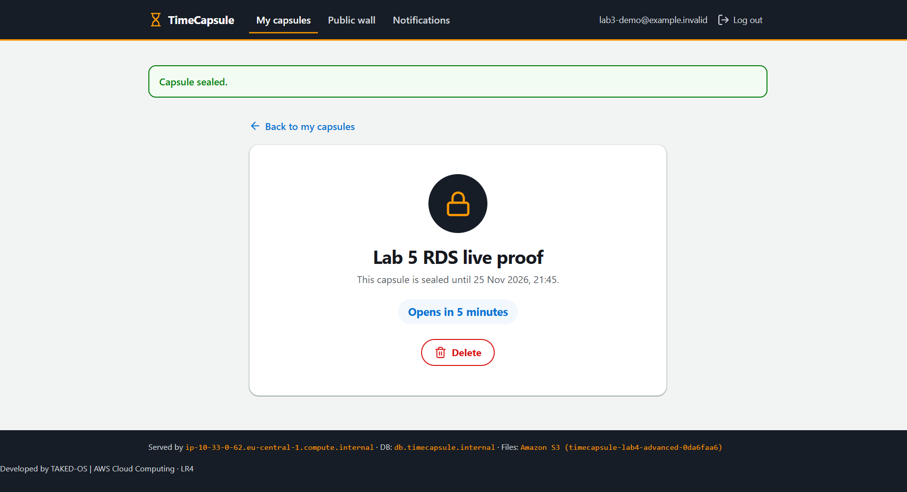
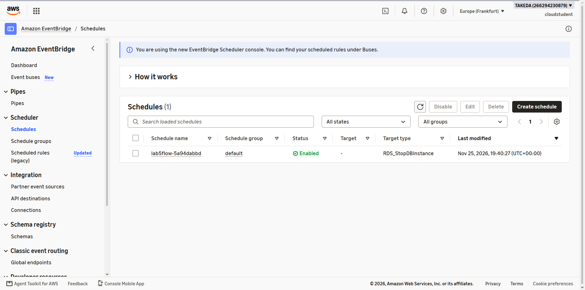
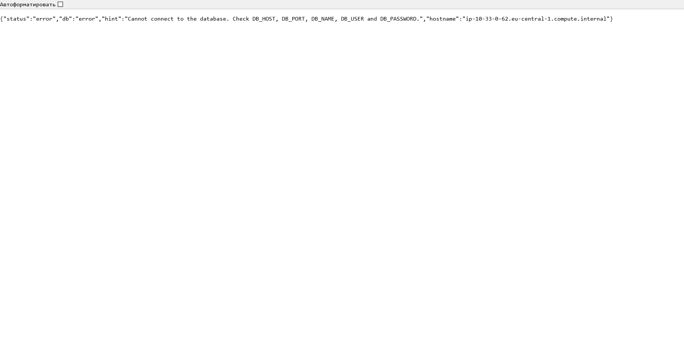

# Advanced. Миграция приложения в Amazon RDS

[Отчёт Basic](README.md) · [Задание Moodle](https://elearning.usm.md/mod/assign/view.php?id=344592)

## База, права и перенос

Создал приватную RDS PostgreSQL 16.13 Single-AZ, `db.t4g.micro`, gp3 20 ГиБ. Для приложения создал отдельного пользователя и базу. В этом аккаунте AWS возвращал `FreeTierRestrictionError` для семидневного хранения бэкапов. В практическом прогоне использовал один день.

Перенёс данные через `pg_dump` и `psql`. До переключения в обеих базах было 2 пользователя и 3 капсулы. Соединение с RDS использовало TLS 1.3. Заменил приватную A-запись на CNAME к endpoint RDS. Приложение подключилось по прежнему имени `db.timecapsule.internal` и получило `db: ok`. Новая капсула №5, созданная в браузере, появилась в RDS.

## Scheduler и обслуживание

Одноразовое расписание с отдельной ролью вызвало `StopDBInstance`. CloudTrail подтвердил операцию, а состояние RDS изменилось на `stopping`. Постоянное ночное расписание не оставлял после теста.

Во время контрольной перезагрузки и после остановки `/health` возвращал HTTP 500. После повторного запуска endpoint сохранился, приложение вернуло HTTP 200. Временная RDS и её зависимости удалены, исходная A-запись восстановлена.

## Контрольные вопросы

- Браузер обращается к приложению. PHP разрешает приватное имя БД, группа безопасности RDS пропускает TCP 5432 от группы приложения, а PostgreSQL проверяет подключение и права пользователя. Соединение с базой шифруется TLS.
- Реплика получает изменения с основной базы, включая ошибочные удаления. Резервные копии и журналы позволяют восстановить состояние на выбранный момент.
- Для отказа зоны подошёл бы RDS Multi-AZ с автоматическим переключением и узлом в другой зоне. Такая конфигурация добавляет расходы на вычисления и хранилище. В учебном прогоне использовал Single-AZ.
- RDS автоматически запускается после семи дней остановки. Проверил одноразовый вызов остановки. Постоянное ночное расписание и автоматический повтор после семи дней не проверял.

[Архитектура](advanced-evidence/architecture.md) · [ADR-0004](advanced-evidence/ADR-0004.md)
