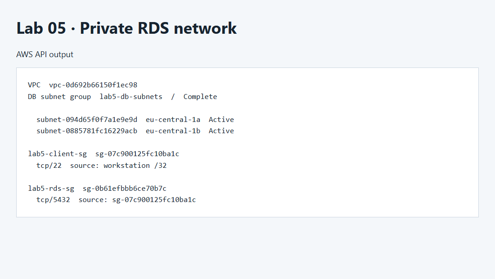
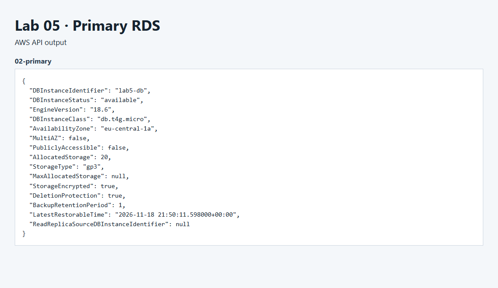
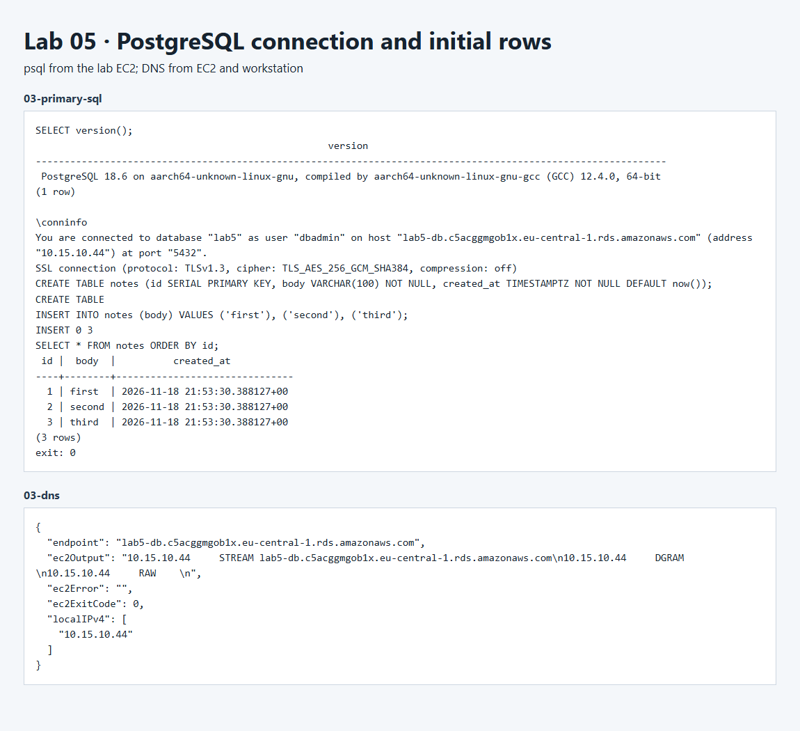
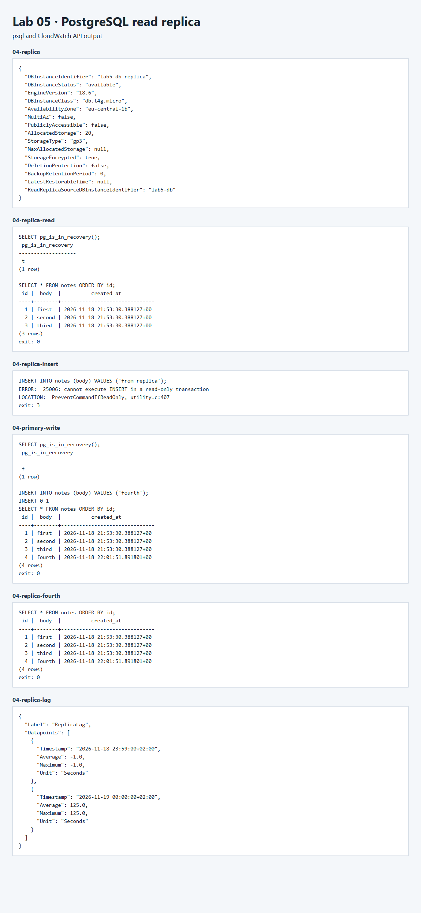
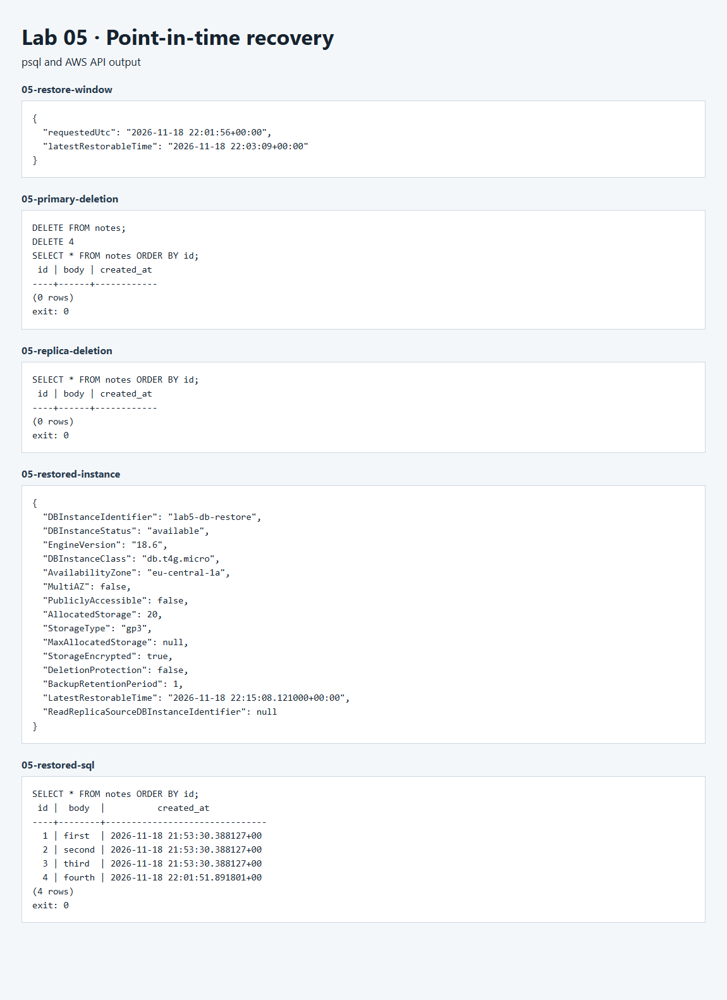
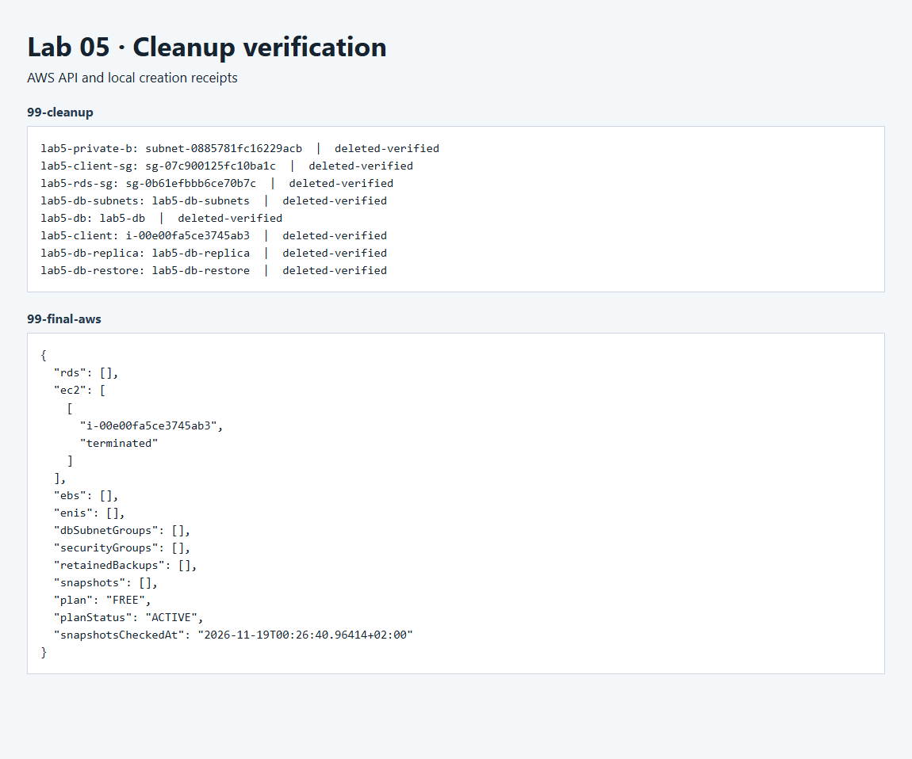

# Лабораторная работа №5. Amazon RDS for PostgreSQL

**Студент:** Мартынюк Петр\
**Группа:** IA2404\
**Специальность:** Informatică aplicată\
**Дисциплина:** Cloud Computing\
**Уровень:** Basic, задания 1–5\
**Дата:** 18–19 ноября 2026 года\
**Регион:** Europe (Frankfurt), `eu-central-1`

Цель — развернуть приватную RDS PostgreSQL, проверить доступ с EC2, репликацию и восстановление к выбранному моменту. Сохранены подтверждённые ответы AWS API и фактический вывод `psql` с учебного EC2. Скриншоты показывают эти данные, открытые локально в браузере.

**Отклонения от Moodle.** С согласия пользователя применён AWS Free Plan. Для этого тарифа AWS показывает шаблон Free tier. Ранее `CreateDBInstance` с `BackupRetentionPeriod=7` вернул `FreeTierRestrictionError`. В этом запуске основной экземпляр настроен с **1 днём** хранения автоматических бэкапов (`BackupRetentionPeriod=1`). Тариф не менялся. [Задание Moodle](https://elearning.usm.md/mod/assign/view.php?id=344592) · [Документация RDS о шаблонах](https://docs.aws.amazon.com/AmazonRDS/latest/gettingstartedguide/create-instance-overview.html)

Перед запуском AWS подтвердил **$170.46** кредитов, 40 доступных мест для экземпляров RDS и 50 для групп подсетей. Оценка прогона — около **$0.13** до кредитов и налогов при 4 экземпляро-часах RDS суммарно и 2 часах EC2, без небольшого сетевого трафика. Это оценка по тарифам региона. [Тарифы RDS](https://aws.amazon.com/rds/postgresql/pricing/)

## 1. Размещение и доступ

В существующей VPC №3 `vpc-0d692b66150f1ec98` создана приватная `lab5-private-b` в `eu-central-1b` с CIDR `10.15.12.0/24`. Она использовала существующую основную таблицу с маршрутом `local`. В `lab5-db-subnets` также вошла существующая `private-a` в `eu-central-1a`. AWS подтвердил статус группы `Complete`. `lab5-rds-sg` разрешала TCP 5432 только от `lab5-client-sg`. SSH к клиенту был открыт с IP рабочей станции `/32`. NAT Gateway для этой схемы не нужен.

**Почему SG источника?** Правило проверяет членство интерфейса в клиентской группе безопасности. При замене клиента или изменении IP правило менять не требуется. **Зачем две зоны?** Группа подсетей задаёт доступные зоны RDS; основная база Single-AZ занимает одну из них, а вторую можно выбрать для реплики.

## 2. Основная база

AWS подтвердил `lab5-db` в состоянии `available`. Экземпляр использовал PostgreSQL 18.6, `db.t4g.micro`, Single-AZ в `eu-central-1a`, gp3 20 ГиБ, без автоприроста, без публичного доступа. Шифрование и deletion protection включены. Созданы база `lab5` и пользователь `dbadmin`. Срок хранения автоматических бэкапов — 1 день.

**Как проверить доступ?** API должен показать приватный экземпляр и входящий 5432 только от клиентской SG, а соединение из этой группы проверяется `psql`. **Почему зона 1a?** Это условие задания. В ней уже есть исходная приватная подсеть, а клиент в той же зоне. **Что защищает deletion protection?** Она блокирует удаление экземпляра до отключения настройки. SQL-операции, например `DELETE FROM notes`, выполняются с обычными правами пользователя.

## 3. Подключение и таблица

С временного EC2 `lab5-client` в `eu-central-1a` выполнено подключение через `psql`. `SELECT version()` вернул PostgreSQL 18.6, а `\conninfo` показал базу `lab5`, пользователя `dbadmin`, порт 5432 и TLS 1.3. Создана таблица `notes`, вставлены и прочитаны три строки — `first`, `second`, `third`. DNS-разрешение RDS endpoint с EC2 и с рабочего компьютера вернуло приватный адрес `10.15.10.44`.

## 4. Реплика для чтения

На активном Free Plan создана приватная Single-AZ `lab5-db-replica` в `eu-central-1b` с классом `db.t4g.micro`. Источник по AWS API — `lab5-db`. На реплике `pg_is_in_recovery()` вернул `t`, на основной базе — `f`. Первые три строки были видны на реплике. Попытка записи отклонена с SQLSTATE `25006` (`cannot execute INSERT in a read-only transaction`). После записи на основной базе на реплике появилась строка `fourth`.

CloudWatch вернул значения `ReplicaLag` `-1` и `125` секунд. `-1` означает, что RDS в тот момент не определил задержку. У PostgreSQL метрика измеряет время с последней применённой транзакции. Доставку `fourth` подтверждает отдельный SQL-запрос. [Метрика ReplicaLag для PostgreSQL](https://docs.aws.amazon.com/AmazonRDS/latest/UserGuide/USER_PostgreSQL.Replication.ReadReplicas.Monitor.html)

**Почему запись отклонена?** PostgreSQL-реплика работает в режиме восстановления и применяет WAL основной базы. Изменения через её endpoint запрещены. **Чем отличается от Multi-AZ standby?** Read Replica асинхронно обслуживает чтение через собственный endpoint. Синхронный standby развёртывания RDS Multi-AZ с одним резервным экземпляром предназначен для автоматического failover. [Реплики PostgreSQL](https://docs.aws.amazon.com/AmazonRDS/latest/UserGuide/USER_PostgreSQL.Replication.ReadReplicas.html) · [Multi-AZ DB instance](https://docs.aws.amazon.com/AmazonRDS/latest/UserGuide/Concepts.MultiAZSingleStandby.html)

## 5. Восстановление на момент времени

1. На основной базе выполнен `SELECT now() AT TIME ZONE 'UTC'`. Запрос на восстановление использовал **18.11.2026 22:01:56 UTC** (19.11.2026 00:01:56 в Кишинёве).
2. Через минуту `DELETE FROM notes` удалил 4 строки. Последующее чтение вернуло 0 строк и на основной базе, и на реплике. Реплика удалена после проверки.
3. RDS показывал `LatestRestorableTime = 18.11.2026 22:03:09 UTC`. На Free Plan выполнен `RestoreDBInstanceToPointInTime` для выбранного UTC-времени.
4. Приватная Single-AZ копия `lab5-db-restore` на `db.t4g.micro` стала `available`. Запрос `SELECT * FROM notes ORDER BY id` вернул **четыре строки — `first`, `second`, `third`, `fourth`**. Это подтверждает восстановление состояния до удаления.

**Почему реплика не спасает строки?** Удаление передаётся через WAL и применяется на реплике. **Почему PITR создаёт отдельный экземпляр?** RDS восстанавливает резервную копию и применяет журналы до выбранной точки в новом экземпляре. Исходный экземпляр сохраняется для проверки и последующего решения о переключении. [Документация PITR](https://docs.aws.amazon.com/AmazonRDS/latest/UserGuide/USER_PIT.html)

## Завершение и инвентаризация

Все пять упражнений Basic выполнены на Free Plan с указанным отклонением по сроку хранения. После сохранения результатов RDS удалены без финальных снимков и без сохранения автоматических бэкапов. На основной базе перед удалением отключена защита. Выполнение завершилось с кодом 0. Итоговая инвентаризация выполнена через AWS API **19 ноября 2026 года в 00:26 по Кишинёву**.

| Созданный ресурс | Точный идентификатор | Итог |
|---|---|---|
| Основная RDS | `lab5-db` | Удалена |
| Реплика | `lab5-db-replica` | Удалена |
| Копия PITR | `lab5-db-restore` | Удалена |
| EC2-клиент | `i-00e00fa5ce3745ab3` | `terminated` |
| Корневой EBS | `vol-0a84a8039cfe0b2ce` | Удалён |
| ENI клиента | `eni-0fd4811c805610618` | Удалён |
| Группа подсетей RDS | `lab5-db-subnets` | Удалена |
| Группа безопасности базы | `sg-0b61efbbb6ce70b7c` | Удалена |
| Группа безопасности клиента | `sg-07c900125fc10ba1c` | Удалена |
| Приватная подсеть №5 | `subnet-0885781fc16229acb` | Удалена |

Повторная проверка `DescribeDBSnapshots` показала, что все три ранее видимых системных снимка исчезли. Список снимков для основной базы, реплики, копии PITR и отдельного пилота пуст. `DescribeDBInstanceAutomatedBackups` подтвердил отсутствие сохранённых автоматических бэкапов. [Как RDS удаляет автоматические бэкапы](https://docs.aws.amazon.com/AmazonRDS/latest/UserGuide/USER_DeleteInstance.html)

Free Plan остался активным. Для №6 сохранены исходная VPC №3, `public-a` и `public-b` в разных зонах, их таблица маршрутов с Internet Gateway и пара ключей `cloudstudent-keypair`. Bastion сохранён в состоянии `stopped`. Настройки существующих ресурсов TimeCapsule не менялись. Работающих ресурсов №5 нет.

## Вывод

На этом AWS Free Plan удалось создать Single-AZ Read Replica для обычной RDS PostgreSQL и восстановить отдельный экземпляр методом PITR в пределах однодневного окна. Это показали реальные SQL-запросы на реплике и восстановленной базе. Семидневный срок отклонён AWS при создании и отражён как согласованное отклонение от Moodle.
