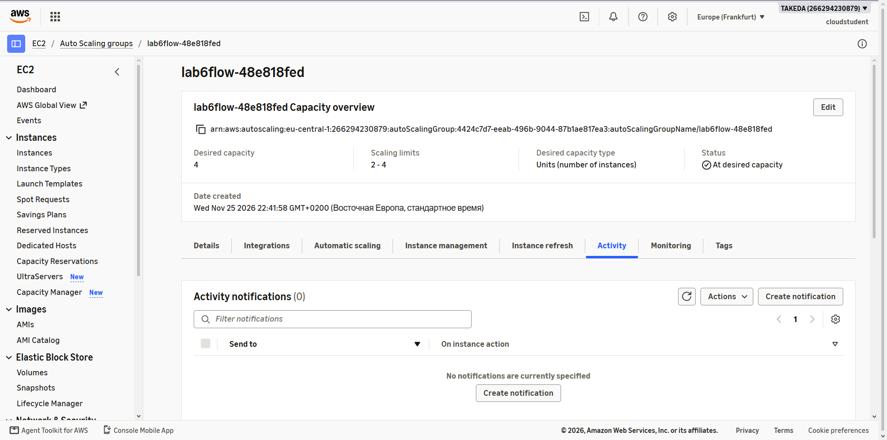

# Advanced. Сессии приложения и масштабирование

[Отчёт Basic](README.md) · [Задание Moodle](https://elearning.usm.md/mod/assign/view.php?id=346635)

## Общая сессия

В AWS SDK для PHP зарегистрировал обработчик сессий DynamoDB до `session_start()`. В таблице подтвердил `id: S`, `data: S`, `expires: N`. DynamoDB удаляет истёкшие записи асинхронно. При чтении сессии срок её действия проверяется отдельно. Экземпляры использовали IAM instance profile. Временный RDS из ЛР5 уже был удалён, поэтому в этом прогоне использовал сохранённую учебную PostgreSQL на EC2.

После одного входа та же cookie дала доступ к защищённой странице на экземплярах двух зон за ALB. Прямой HTTP к ALB блокировался в Opera. Проверки приложения выполнены через CLI, снимки показывают реальную консоль AWS.

## Нагрузка и изменение ёмкости

CloudWatch поднял верхнюю тревогу после точек 13, 49 и 50 при пороге 12 запросов на цель. ASG выросла с двух до четырёх. При четырёх узлах создал новую капсулу через ALB, затем продолжил открывать приложение с той же авторизацией.

После 15 точек ниже порога сработала нижняя тревога. Целевая ёмкость снизилась с четырёх до трёх. Вновь входить не потребовалось. Возврат к двум не наблюдался до завершения эксперимента.

## Контрольные вопросы

- ALB направляет запрос на здоровый узел PHP. Узел загружает сессию из DynamoDB по идентификатору из cookie и обращается к PostgreSQL за данными приложения.
- Проверка ALB определяет, можно ли направлять запросы на конкретную цель. ASG поддерживает заданную ёмкость и заменяет нездоровые экземпляры, в том числе по результатам проверок ELB, когда этот тип проверки включён.
- При отказе одной зоны ALB может обслуживать запросы через здоровые цели во второй зоне. Сессии остаются в DynamoDB. В этой схеме доступность приложения также зависит от PostgreSQL на одном EC2.

Временные ALB, ASG, экземпляры, таблица, образ, снимки и сетевые зависимости удалены. [Данные CloudWatch](advanced-evidence/request-count-per-target.json) · [Архитектура](advanced-evidence/architecture.md) · [ADR-0005](advanced-evidence/ADR-0005.md)
