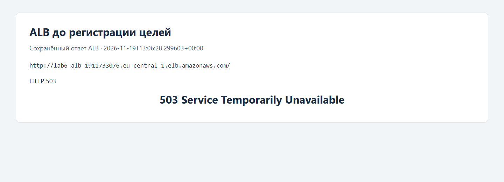
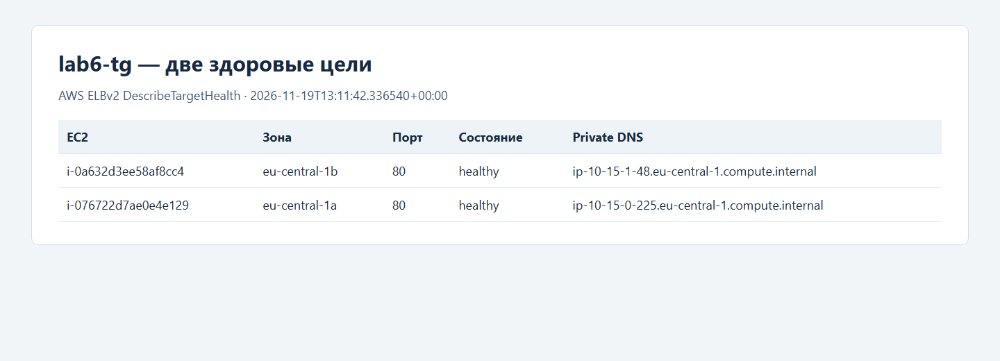
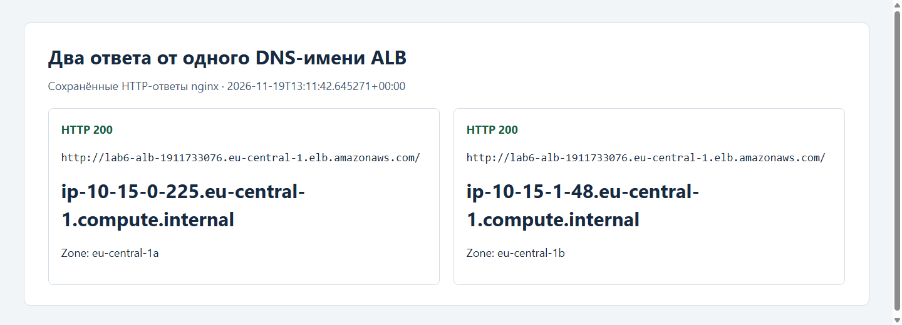
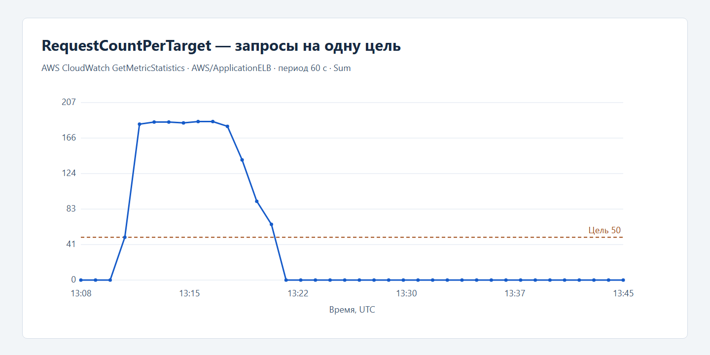
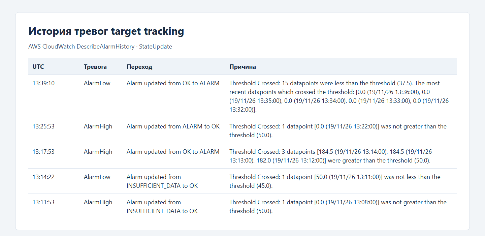
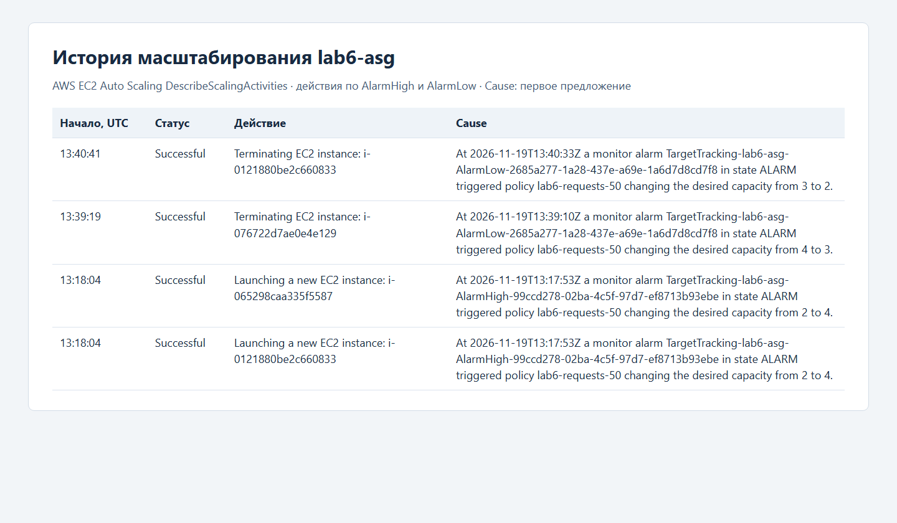

# Лабораторная работа №6. Масштабирование и балансировка нагрузки

**Студент:** Мартынюк Петр\
**Группа:** IA2404\
**Специальность:** Informatică aplicată\
**Дисциплина:** Cloud Computing\
**Уровень:** Basic, задания 1–3\
**Дата:** 19 ноября 2026 года\
**Регион:** Europe (Frankfurt), `eu-central-1`

Цель работы — распределить HTTP-запросы между экземплярами nginx в двух зонах доступности и проверить изменение размера EC2 Auto Scaling Group по числу запросов на цель. [Задание Moodle](https://elearning.usm.md/mod/assign/view.php?id=346635)

## 1. Балансировщик

Целевая группа `lab6-tg` использовала тип `instance`, протокол HTTP, порт 80 и проверку `/health` каждые 10 секунд. Публичный Application Load Balancer (internet-facing) `lab6-alb` разместили в подсетях ЛР3 `public-a` и `public-b` в зонах `eu-central-1a` и `eu-central-1b`. Учебные ресурсы получили имена с префиксом `lab6-` и тег `Lab=lab6`. Listener HTTP:80 направлял запросы в `lab6-tg`. Группа безопасности ALB разрешала входящий TCP 80 от `0.0.0.0/0`.

**Какой ответ вернул балансировщик и почему?** ALB вернул **HTTP 503 Service Temporarily Unavailable**. Listener уже принимал запросы, но AWS API показал пустой список целей, поэтому перенаправить запрос было некуда.

**Зачем подсети в двух зонах?** Для ALB в обычных зонах доступности AWS требует минимум две подсети в разных зонах и размещает в каждой узел балансировщика. Две зоны обеспечивают доступ к сервису при отказе одной зоны, если в другой зоне остаются здоровые цели. [Application Load Balancer](https://docs.aws.amazon.com/elasticloadbalancing/latest/application/application-load-balancers.html)

## 2. Группа Auto Scaling

Шаблон `lab6-lt` включал Amazon Linux 2023 x86_64, `t3.micro`, пару ключей `cloudstudent-keypair`. Скрипт Moodle устанавливал nginx, записывал hostname и AZ в ответ страницы `/` и создавал `/health` с ответом `OK`. Security Group экземпляров разрешала входящий TCP 80 из SG балансировщика.

ASG `lab6-asg` использовала две публичные подсети, шаблон версии 1, проверки ELB и `lab6-tg`. Начальная и минимальная ёмкость составляли 2, максимальная — 4. Политика `lab6-requests-50` следила за `ALBRequestCountPerTarget` с целевым значением 50 запросов на здоровую цель в минуту.

**Чем ASG отличается от целевой группы?** ASG запускает и завершает EC2 и изменяет число экземпляров согласно политике. Целевая группа регистрирует адресатов ALB, проверяет их здоровье и определяет, куда можно направить HTTP-запрос.

**Почему в шаблоне нет подсети?** Шаблон хранит общие параметры экземпляра. ASG выбирает подсеть при запуске, распределяя экземпляры по заданным зонам.

В `lab6-tg` зарегистрировались две здоровые цели. Обе страницы получены с одного DNS учебного ALB, а отдельный запрос к `/health` вернул `HTTP 200` и `OK`.

| Экземпляр EC2 | Зона | Hostname в ответе |
|---|---|---|
| `i-076722d7ae0e4e129` | `eu-central-1a` | `ip-10-15-0-225.eu-central-1.compute.internal` |
| `i-0a632d3ee58af8cc4` | `eu-central-1b` | `ip-10-15-1-48.eu-central-1.compute.internal` |

## 3. Нагрузка

С локального компьютера отправлялись последовательные HTTP GET только по DNS учебного ALB в течение **600,05 с**. Генератор зафиксировал **3 656 ответов HTTP 200**. Нагрузка шла с **13:11:44 до 13:21:44 UTC**.

В **13:17:53 UTC** `AlarmHigh` перешла в `ALARM`. CloudWatch зафиксировал три минутных значения выше 50. В AWS Auto Scaling Activity поле `Cause` связало тревогу с политикой `lab6-requests-50` и изменением `desired` с **2 до 4**. Оба дополнительных экземпляра зарегистрировались, и AWS подтвердил четыре цели `healthy`.

После остановки нагрузки метрика упала до нуля. В **13:39:10 UTC** `AlarmLow` перевела `desired` с 4 на 3, а в **13:40:33 UTC** — с 3 на 2. После завершения `draining` AWS подтвердил в **13:47:08 UTC** два экземпляра и две цели `healthy` (`i-065298caa335f5587`, `i-0a632d3ee58af8cc4`). Желаемая ёмкость вернулась к 2 примерно через 19 минут после нагрузки, две оставшиеся цели подтверждены через 25 мин 24 с после окончания нагрузки.

**Сколько серверов запустила группа и почему не больше четырёх?** Два экземпляра были запущены при создании ASG, ещё два — в результате target tracking, всего четыре. `MaxSize=4` ограничивала размер группы даже тогда, когда значение метрики всё ещё превышало 50.

**Почему метрика упала после запуска новых серверов?** CloudWatch делит запросы целевой группы за период на число её здоровых целей. При продолжающемся потоке запросов значение снизилось со **185** в 13:17 UTC до **92** в 13:20 UTC после регистрации четырёх здоровых целей. Это соответствует примерно 370 и 368 запросам за минуту суммарно. [Определение RequestCountPerTarget](https://docs.aws.amazon.com/elasticloadbalancing/latest/application/load-balancer-cloudwatch-metrics.html)

**Почему ASG добавляет серверы быстрее, чем убирает?** Увеличение ёмкости защищает доступность при росте нагрузки, а удаление серверов откладывается до устойчивого снижения. Эта политика создала тревогу роста с окном из трёх минутных периодов и порогом выше 50, а для уменьшения — из 15 периодов. При переходе AlarmLow в ALARM AWS зафиксировал 15 точек ниже порога 37,5. [Поведение target tracking](https://docs.aws.amazon.com/autoscaling/ec2/userguide/as-scaling-target-tracking.html)

Скриншоты сделаны в Chromium по сохранённым HTTP-ответам и данным AWS API. График построен по минутным значениям CloudWatch с указанными измерениями ALB и TG. В снимке Activity приведено первое предложение `Cause`.

## Завершение

После фиксации результатов ASG переведена в `min=desired=max=0`. После завершения экземпляров последовательно удалены ASG, ALB с listener, целевая группа, шаблон запуска и обе учебные группы безопасности.

| Ресурсы | Итог по AWS API |
|---|---|
| ASG, ALB, listener, target group, launch template, две учебные SG | Удалены |
| Четыре EC2 Lab-06 | `terminated` |
| Корневые EBS, сетевые интерфейсы и управляемые CloudWatch-тревоги Lab-06 | Отсутствуют |
| VPC, публичные подсети, маршруты, IGW и пара ключей ЛР3 | Сохранены |

**Временных ресурсов Lab-06 не осталось.** Итоговая проверка API выполнена 19 ноября 2026 года в 13:55:44 UTC. Сверены четыре EC2, четыре EBS, шесть ENI и обе управляемые тревоги.

[Продвинутый уровень](Advanced.md)
