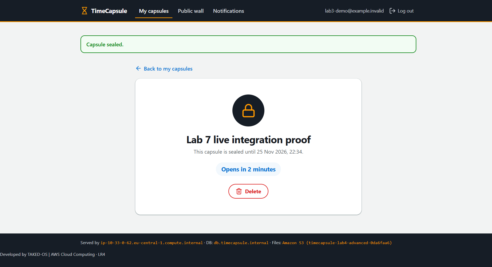
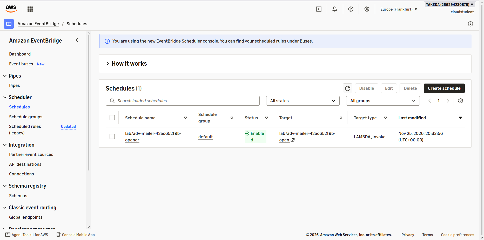

# Advanced. Фоновая обработка событий TimeCapsule

[Отчёт Basic](README.md) · [Задание Moodle](https://elearning.usm.md/mod/assign/view.php?id=348187)

## Запечатывание и уведомление

PHP публиковал `capsule.sealed` в SNS. Подписанная очередь SQS передавала сообщение Lambda. Lambda подключалась по TLS к изолированной PostgreSQL на EC2 и создавала уведомление. Один и тот же идентификатор события обработан дважды, в базе осталось одно уведомление.

Браузерный POST `Seal capsule` занял 3258 мс при синхронной отправке и 634 и 258 мс при публикации в SNS. Это три наблюдения в одном учебном прогоне.

## Открытие по расписанию

Отдельная Lambda открыла капсулу №5 по вызову EventBridge Scheduler. Назначение успешного вызова отправило результат в SNS. Подписанная SQS получила ID капсулы. SQL подтвердил, что она открыта и имеет два разных уведомления. Результат открытия проверил через SQS, email не отправлял.

## Отказ, DLQ и восстановление

Для проверки задал неправильный пароль БД в Lambda и запечатал две капсулы. Обе операции приложения завершились успешно, но сообщения после двух попыток попали в DLQ. В базе было по нулю уведомлений. Исправил подключение и запустил SQS redrive. AWS вернул `COMPLETED`, у каждой капсулы появилось ровно по одному уведомлению.

Удалил временные функции, очереди, темы, расписания, IAM-роли и группы журналов после сохранения доказательств. Вернул исходную конфигурацию изолированного приложения и остановил EC2.

[Журнал до исправления](advanced-evidence/cloudwatch-before-redrive.log) · [Журнал после исправления](advanced-evidence/cloudwatch-after-redrive.log) · [Архитектура](advanced-evidence/architecture.md) · [ADR-0006](advanced-evidence/ADR-0006.md) · [Код издателя](advanced-evidence/publish.php) · [Mailer](advanced-evidence/mailer.py) · [Opener](advanced-evidence/opener.py)
