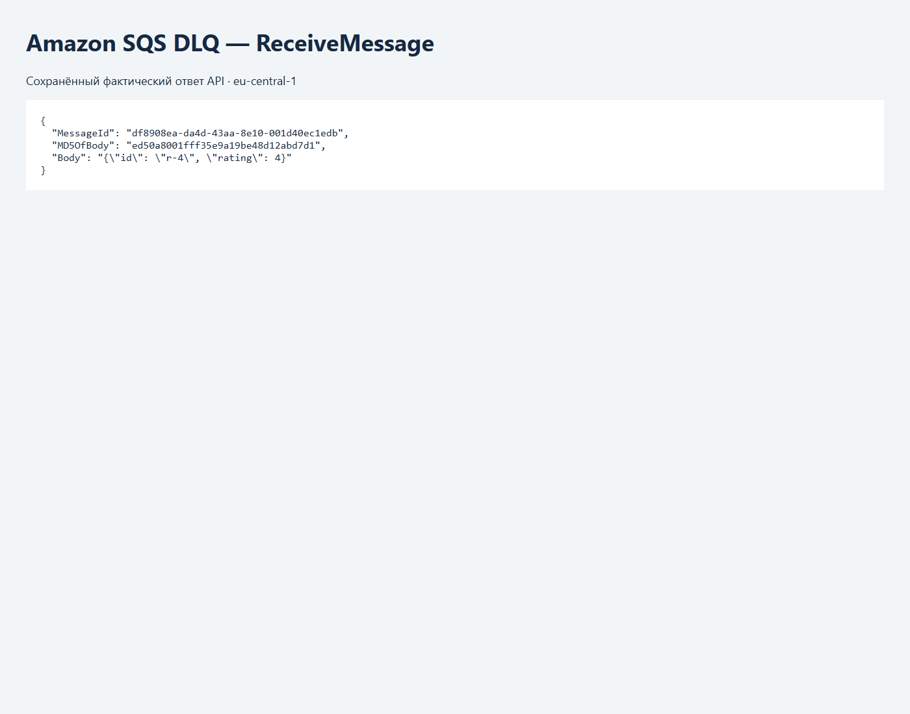

# Лабораторная работа №7. Бессерверные вычисления и события

**Студент:** Мартынюк Петр  
**Группа:** IA2404  
**Специальность:** Informatică aplicată  
**Дисциплина:** Cloud Computing  
**Уровень:** Basic, задания 1–4  
**Дата:** 19 ноября 2026 года  
**Регион:** Europe (Frankfurt), `eu-central-1`

## Цель

Настроить приём отзывов через Amazon SNS, обработку через SQS и Lambda и отправку менеджеру писем с низкими оценками.

`Издатель → SNS lab7-reviews → SQS lab7-reviews-queue → Lambda lab7-review-worker → CloudWatch Logs`

SNS также отправляет подходящие отзывы на почту. Неудачные сообщения из основной очереди переходят в `lab7-reviews-dlq`.

Снимки SQS и CloudWatch показывают сохранённые ответы AWS API, открытые в браузере.

## 1. Тема и очередь отзывов

Созданы стандартная тема и две стандартные очереди. Публикация и опрос выполнялись через AWS API с компьютера. Политика основной очереди разрешает SNS отправлять сообщения только из учебной темы. Фактический ответ SQS на опрос до включения Lambda содержал тело `{"id":"r-1","rating":5,"text":"Fast delivery, good packaging"}` и отдельный атрибут `rating` типа Number со значением 5.

Выбрал видимость 30 секунд, чтобы выдержать рекомендованное AWS отношение 6:1 к таймауту Lambda в 5 секунд. Сообщения в основной очереди хранятся 1 день, а в DLQ 4 дня, чтобы оставалось время изучить сбой и вернуть отзыв. Порог в пять получений позволяет пережить временные ошибки, но ограничивает повторы для сообщения с постоянной ошибкой.

При Raw message delivery тело сообщения SQS — исходный JSON отзыва. Без него SNS добавляет обёртку с метаданными, а отзыв находится в поле `Message` в виде строки. После получения сообщение скрывается на время visibility timeout и снова становится видимым, если потребитель его не удалил. Это произошло с `r-1`, который Lambda затем получила со счётчиком 2.

## 2. Обработчик отзывов

Использовал Python 3.12, 128 МБ памяти и отдельную IAM-роль с доступом к основной очереди и потокам журнала функции. Таймаута 5 секунд достаточно для разбора JSON и записи строки, а размер пачки до 10 позволяет обрабатывать несколько отзывов за вызов при наличии сообщений. В логе для каждого отзыва видны его ID, оценка и первые 20 символов текста.

Для `r-2-1`, `r-2-2` и `r-2-3` понадобилось **три вызова**. У них разные Request ID, а исходный `r-1` обработался отдельно. Число вызовов зависит от того, сколько сообщений потребитель получил одновременно, а также от размера пачки, окна накопления и возможных повторов.

## 3. Ошибочный отзыв и DLQ

В первой версии обязательное поле `text` вызвало `KeyError`. CloudWatch зафиксировал пять получений `r-4` со счётчиками от 1 до 5. SQS переносит сообщение в DLQ после исчерпания `maxReceiveCount`. Между попытками сообщение скрывается на время видимости, поэтому перенос не происходит сразу.

После исправления отсутствующий текст заменяется пустой строкой. Запустил SQS redrive в исходную очередь и получил в CloudWatch строку `r-4: 4/5`.

При ошибке одного сообщения Lambda по умолчанию считает неуспешной всю пачку. Остальные девять сообщений тоже могут прийти повторно после таймаута видимости, даже если функция успела записать часть из них в журнал. Стабильный ID отзыва помогает различать повторы при анализе лога.

## 4. Плохие отзывы на почту

Email-подписка использует фильтр `{"rating":[1,2]}` по атрибутам сообщения. У подписки SQS фильтра нет.

| Отзыв | Почта | Журнал Lambda |
|---|---|---|
| `r-7-1`, оценка 1 | Да, письмо получено | Да |
| `r-7-3`, оценка 3 | По фильтру исключён | Да |
| `r-7-5`, оценка 5 | По фильтру исключён | Да |
| `r-7-no-attr`, без атрибута `rating` | По фильтру исключён | Да |

AWS API подтвердил активную подписку и её политику. Все четыре записи найдены в CloudWatch Logs. За минуту публикации серии SNS зафиксировал 4 публикации и 5 доставок: 4 в очередь и 1 на почту. Ещё 2 уведомления исключены из-за значения атрибута и 1 из-за его отсутствия. Полученное письмо SNS содержит отзыв `r-7-1` с оценкой 1 и текстом `Basic lab review`. Скриншот письма подтверждает доставку вместе с метриками SNS. Во время ранней проверки первого отзыва SNS зафиксировал две доставки на одну публикацию. Это согласуется с тем, что фильтр ещё распространялся. Результаты таблицы относятся только к отдельной серии из четырёх сообщений.

Без атрибута SNS не может сопоставить событие с правилом подписки по атрибутам. Оценка в теле при этом остаётся доступна Lambda. При прямой отправке в очереди издателю пришлось бы добавить адрес новой очереди и собственную логику рассылки, а с SNS новый получатель оформляется отдельной подпиской.

## Завершение

Удалены привязка SQS к Lambda, функция, группа журналов, обе очереди, тема SNS и учебная IAM-роль с её политикой. Действующих подписок и других ресурсов Lab-07 итоговая проверка AWS API не обнаружила. Для ранее снятой email-подписки SNS ещё возвращал запись со статусом Deleted. Выборочная повторная проверка подтвердила прежнее состояние экземпляров TimeCapsule и webserver, обеих VPC, бакетов и проверенных служебных ресурсов.

