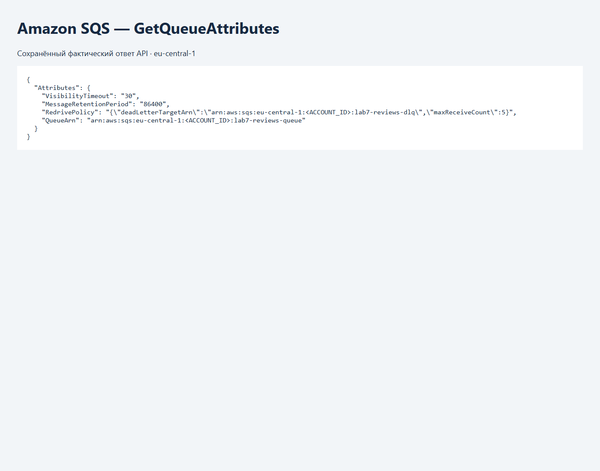
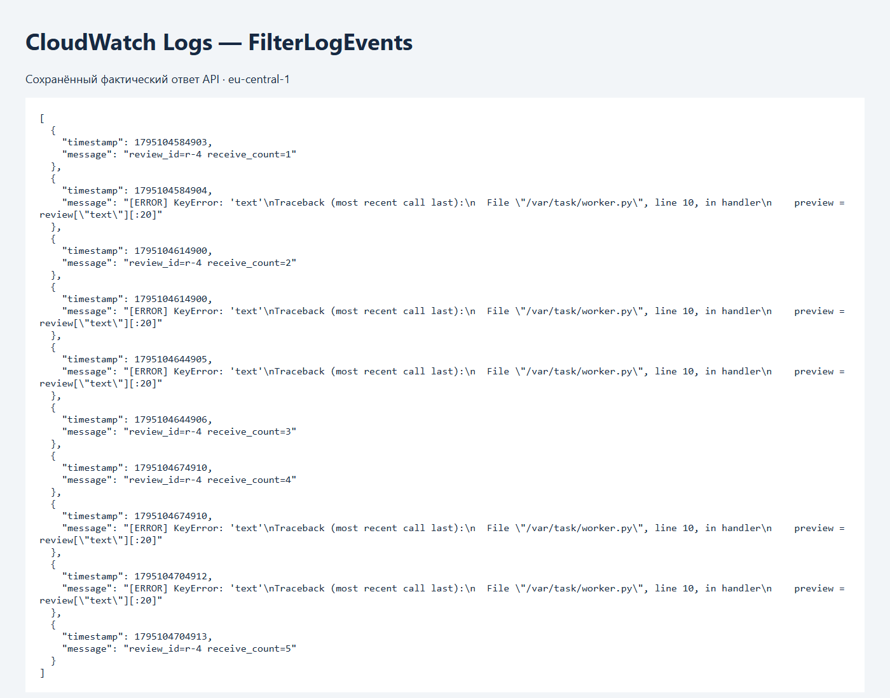
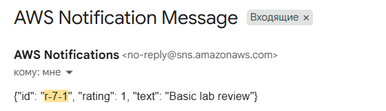
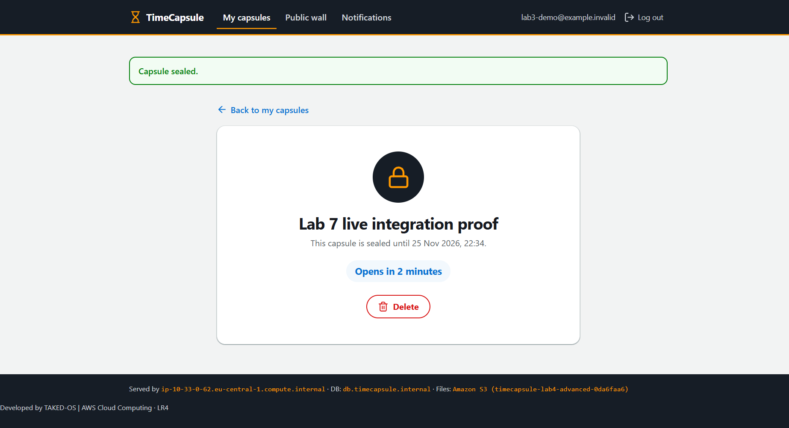
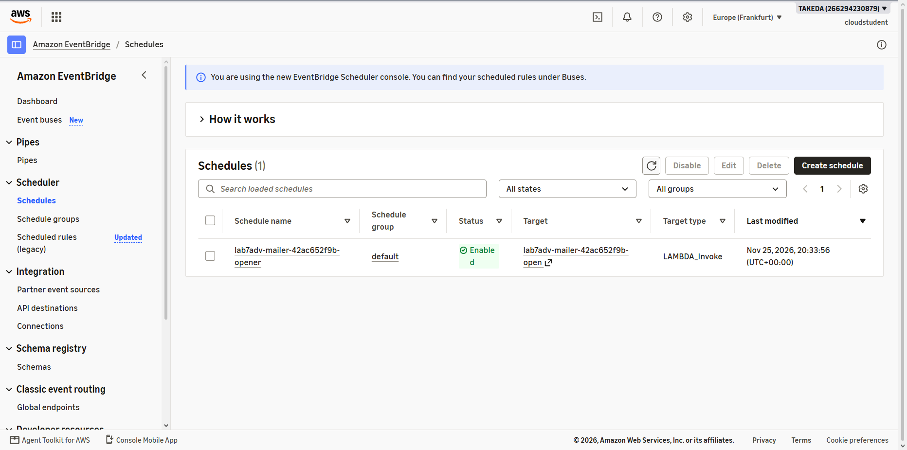

# Лабораторная работа №7. Бессерверные вычисления и события

**Студент:** Мартынюк Петр  
**Группа:** IA2404  
**Специальность:** Informatică aplicată  
**Дисциплина:** Cloud Computing  
**Уровень:** Basic, задания 1–4  
**Дата:** 19 ноября 2026 года  
**Регион:** Europe (Frankfurt), `eu-central-1`

## Цель

Настроить приём отзывов через Amazon SNS, обработку через SQS и Lambda и отправку менеджеру писем с низкими оценками.

`Издатель → SNS lab7-reviews → SQS lab7-reviews-queue → Lambda lab7-review-worker → CloudWatch Logs`

SNS также отправляет подходящие отзывы на почту. Неудачные сообщения из основной очереди переходят в `lab7-reviews-dlq`.

Снимки SQS и CloudWatch показывают сохранённые ответы AWS API, открытые в браузере.

## Basic

### 1. Тема и очередь отзывов

Созданы стандартная тема и две стандартные очереди. Публикация и опрос выполнялись через AWS API с компьютера. Политика основной очереди разрешает SNS отправлять сообщения только из учебной темы. Фактический ответ SQS на опрос до включения Lambda содержал тело `{"id":"r-1","rating":5,"text":"Fast delivery, good packaging"}` и отдельный атрибут `rating` типа Number со значением 5.

Задал тайм-аут видимости очереди 30 секунд. Это в шесть раз больше пятисекундного тайм-аута Lambda, как рекомендует AWS. Сообщения в основной очереди хранятся 1 день, а в DLQ 4 дня, чтобы оставалось время изучить сбой и вернуть отзыв. Порог в пять получений позволяет пережить временные ошибки, но ограничивает повторы для сообщения с постоянной ошибкой.

При Raw message delivery тело сообщения SQS — исходный JSON отзыва. Без него SNS добавляет обёртку с метаданными, а отзыв находится в поле `Message` в виде строки. После получения сообщение скрывается на время visibility timeout и снова становится видимым, если потребитель его не удалил. Это произошло с `r-1`, который Lambda затем получила со счётчиком 2.

### 2. Обработчик отзывов

Использовал Python 3.12, 128 МБ памяти и отдельную IAM-роль с доступом к основной очереди и потокам журнала функции. Таймаута 5 секунд достаточно для разбора JSON и записи строки, а размер пачки до 10 позволяет обрабатывать несколько отзывов за вызов при наличии сообщений. В логе для каждого отзыва видны его ID, оценка и первые 20 символов текста.

Для `r-2-1`, `r-2-2` и `r-2-3` понадобилось **три вызова**. У них разные Request ID, а исходный `r-1` обработался отдельно. Число вызовов зависит от того, сколько сообщений потребитель получил одновременно, а также от размера пачки, окна накопления и возможных повторов.

### 3. Ошибочный отзыв и DLQ

В первой версии обязательное поле `text` вызвало `KeyError`. CloudWatch зафиксировал пять получений `r-4` со счётчиками от 1 до 5. SQS переносит сообщение в DLQ после исчерпания `maxReceiveCount`. Между попытками сообщение скрывается на время видимости, поэтому перенос не происходит сразу.

После исправления отсутствующий текст заменяется пустой строкой. Запустил SQS redrive в исходную очередь и получил в CloudWatch строку `r-4: 4/5`.

При ошибке одного сообщения Lambda по умолчанию считает неуспешной всю пачку. Остальные девять сообщений тоже могут прийти повторно после таймаута видимости, даже если функция успела записать часть из них в журнал. Стабильный ID отзыва помогает различать повторы при анализе лога.

### 4. Отзывы с низкой оценкой по почте

Email-подписка использует фильтр `{"rating":[1,2]}` по атрибутам сообщения. У подписки SQS фильтра нет.

| Отзыв | Почта | Журнал Lambda |
|---|---|---|
| `r-7-1`, оценка 1 | Да, письмо получено | Да |
| `r-7-3`, оценка 3 | По фильтру исключён | Да |
| `r-7-5`, оценка 5 | По фильтру исключён | Да |
| `r-7-no-attr`, без атрибута `rating` | По фильтру исключён | Да |

AWS API подтвердил активную подписку и её политику. Все четыре записи найдены в CloudWatch Logs. За минуту публикации серии SNS зафиксировал 4 публикации и 5 доставок: 4 в очередь и 1 на почту. Ещё 2 уведомления исключены из-за значения атрибута и 1 из-за его отсутствия. Полученное письмо SNS содержит отзыв `r-7-1` с оценкой 1 и текстом `Basic lab review`. Скриншот письма подтверждает доставку вместе с метриками SNS. Во время ранней проверки первого отзыва SNS зафиксировал две доставки на одну публикацию. Это согласуется с тем, что фильтр ещё распространялся. Результаты таблицы относятся только к отдельной серии из четырёх сообщений.

Без атрибута SNS не может сопоставить событие с правилом подписки по атрибутам. Оценка в теле при этом остаётся доступна Lambda. При прямой отправке в очереди издателю пришлось бы добавить адрес новой очереди и собственную логику рассылки, а с SNS новый получатель оформляется отдельной подпиской.

### Завершение

Удалены привязка SQS к Lambda, функция, группа журналов, обе очереди, тема SNS и учебная IAM-роль с её политикой. При завершении Basic AWS API не показал действующих подписок или временных ресурсов этого этапа. Для снятой подписки на почту SNS ещё возвращал статус `Deleted`.

## Advanced

### Запечатывание и уведомление

PHP публиковал `capsule.sealed` в SNS. Подписанная очередь SQS передавала сообщение Lambda. Lambda подключалась по TLS к изолированной PostgreSQL на EC2 и создавала уведомление. Один и тот же идентификатор события обработан дважды, в базе осталось одно уведомление.

Браузерный POST `Seal capsule` занял 3258 мс при синхронной отправке и 634 и 258 мс при публикации в SNS. Это три наблюдения в одном учебном прогоне.

### Открытие по расписанию

Отдельная Lambda открыла капсулу №5 по вызову EventBridge Scheduler. Назначение успешного вызова отправило результат в SNS. Подписанная SQS получила ID капсулы. SQL подтвердил, что она открыта и имеет два разных уведомления. Результат открытия проверил через SQS, email не отправлял.

### Отказ, DLQ и восстановление

Для проверки задал неправильный пароль БД в Lambda и запечатал две капсулы. Обе операции приложения завершились успешно, но сообщения после двух попыток попали в DLQ. В базе было по нулю уведомлений. Исправил подключение и запустил SQS redrive. AWS вернул `COMPLETED`, у каждой капсулы появилось ровно по одному уведомлению.

После сохранения доказательств удалил временную функцию и её очереди, вернул исходную конфигурацию изолированного приложения и остановил EC2. При итоговой проверке AWS всё ещё показывал сетевой интерфейс Lambda в состоянии `in-use`. Удаление связанной группы безопасности и роли отложил до освобождения интерфейса. Проверка всех доступных версий Lambda не нашла функции, которая использует эту группу.

### Контрольные вопросы

- PHP публикует событие после запечатывания капсулы. SNS доставляет его в SQS, а Lambda читает очередь и записывает уведомление. Очередь позволяет пережить временный сбой, а DLQ сохраняет сообщения после исчерпания попыток. Если публикация не удалась и приложение не сохранило событие для повторной отправки, запись уведомления не появится.
- SNS раздаёт событие подписчикам. SQS удерживает сообщение до обработки и позволяет повторить доставку. Проверку дублей выполняет обработчик с помощью идентификатора события.
- Служба Lambda опрашивает SQS через привязку источника событий. Служба также отправляет результат асинхронного вызова в настроенное назначение SNS. Для этих действий коду внутри VPC не нужен выход в интернет. Самому обработчику нужен сетевой доступ к PostgreSQL.
- В ЛР2 приложение выполняло работу на EC2. Здесь AWS управляет доставкой и запуском обработчиков. Код приложения по-прежнему отвечает за публикацию события, обработку дублей, запись в БД и восстановление после ошибок.

[Журнал до исправления](advanced-evidence/cloudwatch-before-redrive.log) · [Журнал после исправления](advanced-evidence/cloudwatch-after-redrive.log) · [Архитектура](advanced-evidence/architecture.md) · [ADR-0006](advanced-evidence/ADR-0006.md) · [Код издателя](advanced-evidence/publish.php) · [Mailer](advanced-evidence/mailer.py) · [Opener](advanced-evidence/opener.py)

## Вывод

Проверил доставку отзывов и фильтрацию уведомлений, затем связал приложение с Lambda и PostgreSQL. После исправления ошибки подключения оба сообщения вернулись из DLQ и обработались без дублей.
