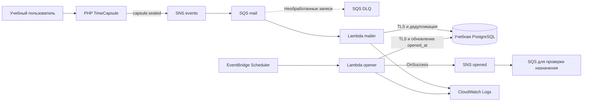

# Архитектура обработки событий

Lambda запускались в приватных подсетях учебной VPC. Для сквозного прогона PostgreSQL работала на EC2. Успешное назначение проверено через SQS, подписанную на SNS. Email в этом прогоне не отправлялся.
